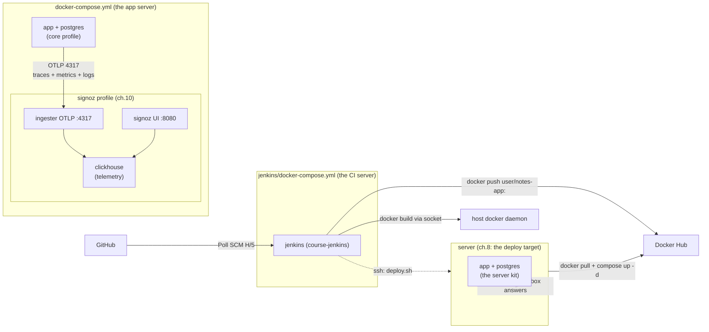

# DevOps Course — one concept at a time

An incremental course that teaches real DevOps habits around a deliberately small
**Notes app** (FastAPI). The app code stays tiny; every branch adds exactly one
DevOps concept around it, and each branch is a complete, working, runnable state.

## Principles
- **One concept per branch.** Nothing else changes. Check out any branch and it works.
- **Free & self-contained.** Docker, Jenkins (in Docker), SQLite → Postgres,
  SigNoz — all local. No cloud account, no Terraform
  (IaC appears as a concept in the docs, not as a tool you must install).
- **uv for Python.** `pyproject.toml` + `uv.lock`; no hand-rolled venvs, no
  `requirements.txt`.
- **MVC-lite, small files.** `models.py` (data), `views.py` (routes),
  `templates/` (Jinja2 UI, one file per page). Each file has one job, so every
  chapter's diff stays readable.
- **A doc per chapter.** `docs/NN-slug.md` teaches the concept *and* explains
  what changed in that branch.

> 📊 **Executive Presentation & Summary**: See [docs/COURSE_SUMMARY.md](docs/COURSE_SUMMARY.md) for concise tables, Mermaid architecture diagrams, and slide-by-slide summaries across all 12 chapters (optimized for PDF export).

## Getting started (ch.0)
1. Install: `git`, `uv` (https://docs.astral.sh/uv/), Docker (daemon running).
2. `make check` — verifies tools, the docker daemon, and that the course's ports
   (8000, 5432, 8080, 4317, 4318, 13000) are free. Read its output; it tells you
   exactly what to fix.
3. Read `PLAN.md` — the full chapter map.
4. `git checkout 01-fastapi` — start chapter 1.

## Architecture (evolving diagram)
One canonical diagram of the system. It is a **snapshot as of this branch** —
rebuild or check out the later branches and you'll watch it grow.

*As of ch.10: the observability box lands — SigNoz joins the app server as
the `signoz` profile (Option A; `signoz/` carries the same stack as its own
project, Option B). The app's one network hop (OTLP gRPC 4317, via the
ingester's `signoz` alias) delivers **all three pillars** — ch.9's traces,
ch.10's metrics, and its JSON logs — into one ClickHouse, cross-linked by
`trace_id`; the UI (:8080) is where the SLO alert and the incident drill
live. Each chapter's doc shows this same diagram at its own snapshot.*

## Branch map
| # | Branch | Concept |
|---|--------|---------|
| 0 | `main` | Course intro, repo layout, git basics |
| 1 | `01-fastapi` | FastAPI app + in-memory store, uv + ruff + Makefile |
| 2 | `02-sqlite` | SQLite + SQLAlchemy, first smoke test |
| 3 | `03-jinja` | Jinja2 UI, one template per page |
| 4 | `04-docker` | Dockerfile (uv-based) |
| 5 | `05-compose` | Docker Compose + Postgres + profiles + secrets story |
| 6 | `06-logging` | Structured (JSON) logging |
| 7 | `07-jenkins-ci` | Jenkins CI pipeline (in Docker): poll on push → lint/scan/test/build → Trivy gate → push to Docker Hub |
| 8 | `08-jenkins-cd` | Deploy stage, image tag = git SHA |
| 9 | `09-otel-health` | `/health`, `/ready`, healthchecks **+** OpenTelemetry tracing, trace_id in logs |
| 10 | `10-signoz` | SigNoz: one tool for traces + metrics + logs, SLO alert + incident drill |
| 11 | `11-testing` | Full test suite in CI |
| 12 | `12-recap` | End-to-end walkthrough, polished Makefile |

## Git model
Branches are kept **side-by-side** (no merges): each is a snapshot of one
concept, so a student can check out any single chapter in isolation.
`main` stays at ch.0; the final state of the whole course lives on `12-recap`.

When teaching a class, the order is: teach branch N on its branch, then move
to branch N+1 (which already contains everything before it).
