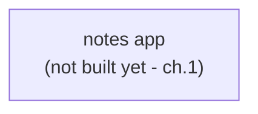

# 00 — Course intro & git basics

## Goal
After this chapter you can set up the environment, explain the course's
branch-per-concept model, and navigate the repo.

## Concept
The course builds one tiny app — the **Notes app** — across 15 branches, adding
exactly one DevOps concept per branch. Why one concept at a time? DevOps topics
compound: you can't appreciate CI without having code that builds, and you can't
appreciate health checks without a container to attach them to. Each branch is a
complete, working snapshot, so you can check out any one in isolation.

**Branches are side-by-side, not merged into each other.** `main` is ch.0;
`15-recap` is the final state. Teach/learn linearly by checking out each branch
in order; each already contains everything the previous branch had.

## What changed in this branch
| File | Why it's here |
|------|---------------|
| `PLAN.md` | The full chapter map + the standing conventions (items 1–10) |
| `README.md` | Course intro + the *first* version of the evolving architecture diagram |
| `Makefile` | `make check` — the prerequisites gate — and `make help` |
| `scripts/check.sh` | The gate's implementation (tool check, docker daemon, port check) |
| `docs/_template.md` | The fixed shape every chapter doc follows |
| `docs/00-intro.md` | This file |
| `.gitignore` | Keeps machine-local state out of git |

No app code yet — that's ch.1's job.

## Try it yourself
1. `make help` — see the command surface.
2. `make check` — fix anything it flags (tools, docker daemon, busy ports).
3. `git branch` — you're on `main`, at ch.0.
4. `git checkout 01-fastapi` — start chapter 1.

## Common pitfalls
- **`make check` flags a busy port.** A tool you already run locally (a real
  Postgres on 5432, a Grafana on 3000/9090) is squatting on a course port.
  The message names the port; use `lsof -iTCP:<port> -P` (macOS) or
  `ss -ltnp | grep :<port>` (Linux) to find the process.
- **The docker daemon is "not reachable" but Docker seems installed.** The
  Docker CLI is installed but the daemon isn't running (Docker Desktop not
  started, or `docker` service stopped on Linux). The check message says which
  to start.
- **`uv` not found after installing.** The installer puts it on a path your
  shell may not know (usually `~/.local/bin`). Reopen the terminal or add it to
  `PATH`.

## Stretch exercise
Set up a second clone of this repo somewhere else, run `make check` there, and
note one difference (e.g. a busy port you discovered by doing it twice).

## Self-check quiz
1. Why does the course keep branches side-by-side instead of merging them into
   each other?
2. What does `make check` verify, and why does every "Try it yourself" start
   with it?
3. Which branch contains the final, complete state of the course?

Answers

1. So any single concept can be checked out and run in isolation, without
   carrying the history of everything that came after it.
2. Tools (git/uv/docker), a reachable docker daemon, and that the course's
   ports are free. It pre-empts the #1 "doesn't work on my machine" cause:
   a dead daemon or a port clash.
3. `15-recap`.

## Classroom demo checklist
- **Live:** `make check` on the instructor's machine (fast, always works);
  `git checkout 01-fastapi && make run` to show how fast the next chapter is.
- **Pre-record / screenshot:** the full branch list (`git branch -a`) if the
  repo has all branches present — it's a better overview image than a live
  scroll.

## Architecture as of this chapter

