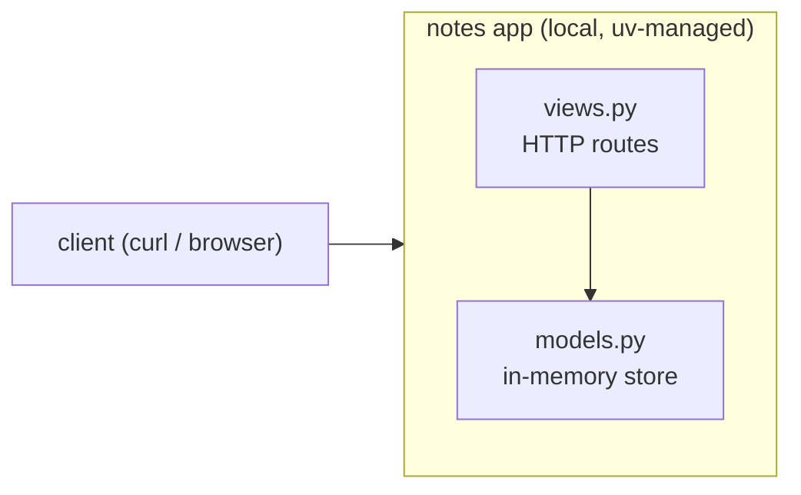

# 01 — FastAPI backend, in-memory store, uv + ruff + Makefile

## Goal
After this chapter you can build a running FastAPI app whose code is split into
three small files (`main.py` / `models.py` / `views.py`), manage its whole
Python environment with `uv`, and drive everything — run, test, lint — through
one `Makefile`.

## Concept
A backend you can *build* but not *operate* is a toy. This chapter adds no
DevOps tooling yet; it creates the **surface** that every later chapter hangs
on:

- **uv** owns the Python environment. `pyproject.toml` declares dependencies,
  `uv.lock` pins exact versions, and `uv run` creates/uses `.venv` for you —
  no `venv` module by hand, no `requirements.txt` to keep in sync. The lockfile
  is the seed of reproducible builds: ch.4's Dockerfile will install *from it*,
  so the image gets byte-identical packages to your machine.
- **MVC-lite** keeps each file to one job. `models.py` knows *where notes
  live*; `views.py` knows *how HTTP maps to actions*; `main.py` just wires
  them. The payoff arrives in ch.2: we rewrite `models.py`'s insides for
  SQLite and **not one line of `views.py` changes**. That is the whole point of
  layering, demonstrated, not asserted.
- **ruff as the one tool.** It lints (`ruff check`) *and* formats
  (`ruff format`) — replacing the flake8/black/isort stack. ch.7's CI "lint"
  stage runs exactly `make lint`, so the rule is enforced where you already run it.
- **A Makefile from day one.** Four targets now, more later. Students type
  `make` targets, not `uv run …` invocations; the toolchain behind the target
  can change without breaking muscle memory. And `make test` working *today*
  is what makes ch.7's CI pipeline meaningful rather than hollow.

## What changed in this branch
| File | Why it's here |
|------|---------------|
| `pyproject.toml` | uv project: `fastapi`, `uvicorn` (runtime) + `pytest`, `httpx`, `ruff` (dev group); ruff + pytest config inline |
| `uv.lock` | Exact versions — the reproducibility artifact |
| `main.py` | One job: create `app`, mount the router |
| `models.py` | The data layer: an in-memory dict with `list/get/create/delete` |
| `views.py` | The controller layer: `GET/POST/DELETE /notes` JSON API + `/` landing |
| `tests/test_app.py` | Two placeholder tests (landing page, CRUD cycle) so `make test` passes on day one |
| `Makefile` | Adds `run` / `test` / `lint` / `lint-fix` on top of ch.0's `check` + `help` |

No `.gitignore` changes on this branch (`.venv/`, `__pycache__/` were already
ignored in ch.0). And note what's **not** in git: `.venv/`. What *is*:
`uv.lock` — that contrast is the whole lesson.

Run it: `make run` → http://127.0.0.1:8000/docs is an auto-generated API UI.

## Try it yourself
```bash
make check && make run          # in one terminal
```
In another terminal:
```bash
make test
make lint
curl -X POST http://127.0.0.1:8000/notes -H 'Content-Type: application/json' -d '{"title":"hello"}'
# → 201, a Note JSON with "id": 1
curl http://127.0.0.1:8000/notes        # → [ {…} ]
curl -X DELETE http://127.0.0.1:8000/notes/1   # → 204
curl http://127.0.0.1:8000/notes/1        # → 404
```
Restart the server (`Ctrl-C`, `make run` again): `curl /notes` → `[]`.
The notes are gone — **that's today's expected behavior**, and ch.2's entire reason to exist.

## Common pitfalls
- **`uv run` says "no Python" / can't find one.** uv downloads and manages
  CPython on demand, but the *first* download needs network. On an air-gapped
  machine: `uv run --python /usr/bin/python3 …` (or set `UV_PYTHON`), which is
  why the Makefile targets use bare `uv run` — it picks up the managed version.
- **`.venv/` appears and someone `git add`s it.** It's gitignored, and must
  stay that way on every branch of this course. What *is* committed is
  `uv.lock`. If a PR deletes the lockfile, that's a red flag.
- **Old app running, new code not loading.** `make run` uses `--reload`, so
  edits to app code reload — but the *server process* itself must be yours
  to kill. `make check` will flag port 8000 as busy and name the PID.
- **`make lint` fails on import order but `make test` passes.** Lint ≠ test:
  run `make lint-fix` once, commit the result. ch.7 makes CI fail on exactly
  this, so learn it now.

## Stretch exercise
Make `make run` accept a port: `make run PORT=9000`. (Hint: one line —
`uv run uvicorn main:app --reload --port $(PORT)` — plus
`PORT ?= 8000` at the top. Then run two instances, side by side, and watch
their note lists stay independent — a preview of *instances vs. state*.)

## Self-check quiz
1. Which file may change when we move from in-memory to SQLite in ch.2 —
   `models.py` or `views.py`? Why?
2. What is `uv.lock` for, and why is it committed even though `.venv/` is
   not?
3. Why does the course give a Makefile on day 1 instead of teaching raw
   `uv run` commands?

<details>
<summary>Answers</summary>

1. `models.py` — it's the only file that knows *where* notes live. `views.py`
   calls model functions and stays identical.
2. It pins the exact resolved versions of every dependency so any machine (and
   ch.4's Docker build) installs identical packages. `.venv/` is machine-local
   state; the lockfile is a source artifact.
3. One stable command surface while the toolchain underneath keeps growing;
   and `make test` working from day 1 gives ch.7's CI pipeline something real
   to run.

</details>

## Classroom demo checklist
- **Live:** `make run`, open `/docs`, create a note with the built-in UI,
  `curl` DELETE it; `make test`; restart the server and show `GET /notes` → `[]`.
- **Pre-record / screenshot:** the full `uv.lock` (too long to scroll live);
  `git diff main..01-fastapi --stat` as a "what this branch added" slide.

## Architecture as of this chapter

