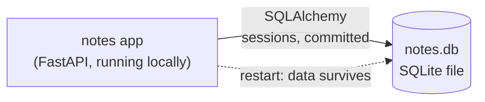

# 02 — SQLite + SQLAlchemy

> After this chapter you can move an app's storage from "gone on restart" to a
> durable database file — and prove it, with a test, without touching the
> request-handling code at all.

## Concept

In ch.1 notes lived in a Python dict. That has a fatal flaw the moment you run
a real server: **restart the process and every note is gone.** A server that
forgets its data after a deploy is not a server, it's a demo.

So: where do the notes go? The classic answer is a relational database. But a
*database server* (Postgres, MySQL) is heavy to install — a daemon, a user, a
port, a socket. For one branch we want the storage lesson with zero new
infrastructure, and SQLite is exactly that: a real, ACID relational database
that lives in **a single file** (`notes.db`). No daemon. No install. The whole
"relational table, primary key, commit/rollback" mental model is available
today; when ch.5 adds Postgres, nothing about the model layer moves.

We don't hand-write `SELECT`/`INSERT` SQL — we use **SQLAlchemy 2.0**, Python's
standard ORM: `NoteRow` describes the table once, and `session.query(...)` /
`session.add(...)` does the rest. One tool, one idiom, and it already speaks
Postgres dialect in ch.5.

And the chapter's quiet hero: **the layering lesson from ch.1 pays off.** The
store swap happens entirely inside `notes_app/models.py`. `views.py` and
`main.py` are byte-for-byte unchanged, and `test_app.py` (the ch.1 API test)
passes without editing a line. A well-drawn seam is worth exactly one
unchanged file.

## What changed in this branch

| File | Change |
|------|--------|
| `notes_app/models.py` | **Full rewrite of the inside.** In-memory dict → SQLAlchemy ORM on SQLite: `NoteRow` table, an `engine`, `create_note`/`get_note`/`list_notes`/`delete_note` now do real DB work. The four public functions keep the exact same signatures, and `Note` (the dataclass the API serializes) is unchanged. |
| `notes_app/views.py` | **Unchanged** — that's the point. Read it once and confirm. |
| `notes_app/main.py` | **Unchanged.** |
| `tests/conftest.py` | New. Sets `DATABASE_URL` to a throwaway temp file **before** `notes_app` is imported, so the test suite never touches your `notes.db`. First real use of pytest fixtures. |
| `tests/test_smoke.py` | New. The first *persistence* test: a CRUD cycle plus a "second connection sees the row" proof. |
| `pyproject.toml` | `sqlalchemy` added to dependencies; `uv.lock` updated. |
| `.gitignore` | `*.db` already ignored from ch.0 — `notes.db` is local state, never committed. |
| `docs/02-sqlite.md` | This file. |

New concepts named in the code: **ORM** (objects ↔ rows), **engine** (the
connection pool / DB driver), **session** (one unit of work — open it, commit
it, close it), **`DATABASE_URL`** (the one env var that will point this same
module at Postgres in ch.5), and **fixtures** (shared test setup, run once
per suite, visible to every test).

## Try it yourself

From a clean checkout of `02-sqlite`:

```bash
make check && uv sync
```

Then the persistence proof, in two terminals:

```bash
make run                # terminal 1: starts uvicorn on :8000
```

```bash
curl -s localhost:8000/notes -H 'Content-Type: application/json' -X POST \
     -d '{"title": "survives restart", "body": "prove it"}'
# -> {"id": 1, "title": "survives restart", ...}
curl -s localhost:8000/notes
```

Now the moment that didn't exist in ch.1 — stop the server (`Ctrl-C` in
terminal 1), look at the file, then start it again:

```bash
ls -la notes.db          # the data lives on disk, not in the process
make run                 # terminal 1 again
curl -s localhost:8000/notes
# -> your note is still here
```

And peek at the raw table without the ORM:

```bash
uv run python -c "import sqlite3; print(sqlite3.connect('notes.db').execute('select * from notes').fetchall())"
```

Finally, the test suite — the CI pipeline in ch.7 will run exactly this:

```bash
make test
```

Expected: `test_app.py` (ch.1's two tests) still passes — unmodified — plus the
two new smoke tests. 4 passed.

## Common pitfalls

1. **"Notes disappeared" → you're editing the wrong `notes.db`.**
   `sqlite:///notes.db` is a *relative* path: it resolves to wherever uvicorn
   was *started*. Run the app from two directories and you have two
   databases. Start it from the repo root, like `make run` does. (In ch.4's
   Docker this becomes explicit: `DATABASE_URL` + a volume.)

2. **"Wrote it, but it's not in the DB" — commit/refresh confusion.** A
   session is a unit of work: `session.add()` stages a row, `commit()` makes
   it durable *and* expires the row's in-memory attributes (the default
   `expire_on_commit=True`), so a `refresh()` *inside the session* is needed
   before reading `row.id` and friends. Get the order wrong and you get the
   classic `DetachedInstanceError` — read the answer to quiz Q3 for the why.
   The smoke test exists precisely to catch "I stored it in memory, not the
   DB."

3. **"database is locked" under concurrent writes.** SQLite allows one writer
   at a time; others wait up to the `timeout` we set on the engine (30s).
   You won't hit it with this course app, but it's *the* classic SQLite
   deployment failure — and it's the reason ch.5 exists: Postgres handles
   many writers properly.

4. **Tests clobbering your data.** If you import `notes_app.models` *before*
   `conftest.py` sets `DATABASE_URL`, you get the repo's real `notes.db`.
   `conftest` runs first (that's its job), but the rule to remember:
   `models.py` reads the env var **at import time** — order matters.

## Stretch exercise

Make a *bad* `DATABASE_URL` fail loudly: run the app against a path whose
directory doesn't exist,

```bash
DATABASE_URL=sqlite:////tmp/no-such-dir/notes.db uv run uvicorn notes_app.main:app
```

Watch it raise `OperationalError: unable to open database file` *at import
time* — the engine's `create_all` tries to open the file to make the table.
Then `mkdir -p /tmp/no-such-dir` and re-run; it works. One sentence: the fix
was the **path**, not the code, because the module treats `DATABASE_URL` as
an opaque contract — that's exactly what makes ch.5's Postgres swap a
configuration change, not a code change. (Note why `make test` won't show
this failure: `conftest.py` deliberately overrides the env var to a temp
file — that's the isolation you saw working.)

## Self-check quiz

1. What changed in `views.py` this chapter? Why is that the feature, not an
   oversight?
2. Where does `DATABASE_URL` get read, and why does that make test setup a
   matter of *import order*?
3. In `create_note`, why call `session.commit()` *and then* `session.refresh(row)`
   — what does each one do that the other doesn't?
4. What's the *only* thing that changes between this chapter and ch.5's
   Postgres? What stays the same?
5. Why `check_same_thread: False` in the SQLite `connect_args`?

<details>
<summary>Answers</summary>

1. Nothing. `models.py` kept its four public functions' signatures, so the
   controllers don't notice. That's what a layer seam is *for* — if a storage
   swap requires touching routes, the seam is in the wrong place.
2. At module import time, in `models.py` (`os.environ.get(...)`). Because of
   that, whichever value of `DATABASE_URL` exists *at import* wins — so the
   fixture must set it before `notes_app` is ever imported, which is exactly
   why it lives in `conftest.py` (imported by pytest before test modules).
3. `commit()` makes the row durable in SQLite — and, with the default
   `expire_on_commit=True`, wipes the object's in-memory attribute values.
   `refresh(row)` (which must run *inside* the session) re-queries the row
   from the DB and repopulates them, including the DB-assigned `id`. Skip
   the `refresh` and `_to_note(row)` raises `DetachedInstanceError` — the
   session is already closed by then.
4. The `DATABASE_URL` value (and the Docker/Compose wiring around it). The
   `models.py` module — ORM, sessions, the four functions — is unchanged,
   because SQLAlchemy speaks both dialects.
5. uvicorn serves requests across a thread pool; SQLite connections default
   to "one thread, one connection" and would raise `ProgrammingError` the
   moment a second thread touched one. The flag says the pool may hand a
   connection to any thread; our `timeout` handles the actual write-lock
   safety.

</details>

## Classroom demo checklist

**Show live** (fast, satisfying, low-risk):
- `curl` POST → `Ctrl-C` uvicorn → `curl` POST again → old note **still
  there**. The restart-survival moment, ~20 seconds, zero setup risk.
- `make test` — 4 passed, and point out `test_app.py` needed *zero edits*
  when the storage changed.
- Peek at the raw table with `sqlite3` (one line, above).

**Pre-record / screenshot** (slow or risky live):
- The stretch exercise's failure (`no-such-dir` engine error) — it's
  educational but the traceback is long on a projector; one screenshot.

## Architecture as of this chapter

The canonical diagram, updated for this branch (ch.0's single box gains its
first dependency):



Next chapter (ch.3) adds Jinja templates in the same `views.py` — the diagram
shape doesn't change; ch.4's Dockerfile is the next one to.
