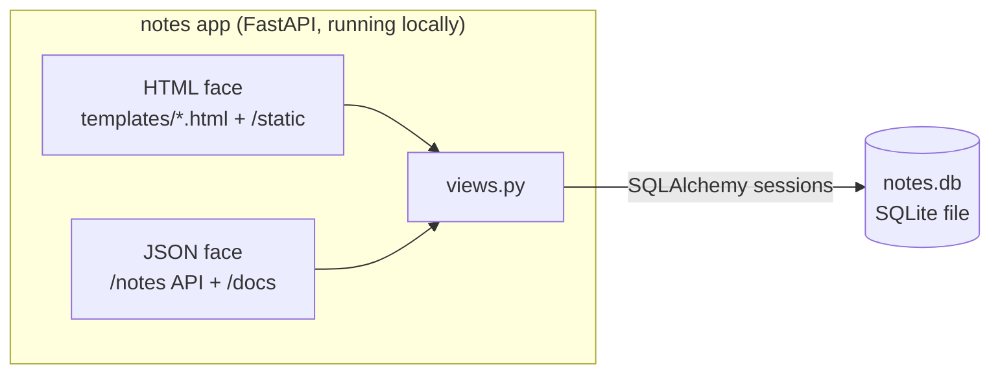

# 03 — Jinja2 UI, MVC in place

> After this chapter you can serve rendered HTML pages from the same FastAPI
> app that serves JSON — without the two ever talking over each other.

## Concept

So far students open a browser to the app and get a JSON blob. Real
applications have two consumers: a **browser** that wants rendered HTML, and
**API clients** (curl, other services, a mobile app) that want JSON. The
wrong way to do that is two apps, or one pile of routes where HTML strings
and JSON responses tangle together.

**Jinja2** is Python's standard template language — it takes your model data
and renders it into HTML on the server. FastAPI ships a ready-made mount
(`Jinja2Templates`) and a static-files mount, so "server-rendered page" is a
few lines in `main.py` and one small template per page.

The MVC payoff lands here, which is the whole reason this is its own branch:

- **Model** — `models.py`: reads/writes SQLite. *Untouched this chapter.*
- **View** — `templates/*.html`: pure presentation, one file per page.
- **Controller** — `views.py`: the only place that knows both exist. The
  HTML routes render templates; the JSON routes serialize the same `Note`.

Both faces call the *same* `create_note` / `list_notes`. The form on the
"new note" page and `curl POST /notes` create the identical row. That's what
"two faces of one dataset" means.

## What changed in this branch

| File | Change |
|------|--------|
| `templates/base.html` | New. The layout: header, nav, `<main>` block, footer, static asset links. Every page extends it — one place to change the look. |
| `templates/index.html` | New. "All notes" page — loops the list, empty state, link to each note. |
| `templates/new.html` | New. The create form (`<form action="/new" method="post">`). |
| `templates/show.html` | New. A single note, titled by its own title, plus a **Delete** button (POSTs `/note/{id}/delete` — forms can't send DELETE verbs). |
| `static/style.css`, `static/app.js` | New. A minimal stylesheet and a *deliberately tiny* JS file. The JS is not decoration: it proves static file serving works and gives ch.3 a visible "static assets" concept in one line. |
| `notes_app/main.py` | Learned to serve HTML: mounts `Jinja2Templates` + `StaticFiles` at the repo-root `templates/` & `static/` directories, and stashes them on `app.state` for views. |
| `notes_app/views.py` | **Grew, didn't rewrite.** The JSON routes are unchanged; a new HTML section above them renders the four pages. `POST /new` accepts form data (`Form(...)`) and 303-redirects to the new note (the PRG pattern — POST/Redirect/Get — so a refresh after submit doesn't re-post). |
| `pyproject.toml` + `uv.lock` | `jinja2` (a uvicorn-extra anyway, now direct) and `python-multipart` (FastAPI needs it to parse `Form` bodies). |
| `tests/test_app.py` | Rewritten: home page is HTML now; the JSON CRUD test renamed; a new test walks the HTML flow (open `/new`, POST the form, follow to the show page, see the note in the JSON API). |

Nothing changed in `models.py`. Check it with `git diff 02-sqlite..03-jinja
-- notes_app/models.py` — empty.

## Try it yourself

From a clean checkout of `03-jinja`:

```bash
make check && uv sync
```

```bash
make run        # terminal 1
```

Open a browser at `http://localhost:8000/` — you should get the *HTML* home
page now (the empty state: "No notes yet"), not JSON.

```
/new            -> the create form
submit "Buy milk"
/note/1        -> the fresh note, rendered
```

Then the moment that proves it's *one* dataset — in terminal 2:

```bash
curl -s localhost:8000/notes
# -> [{"id":1,"title":"Buy milk","body":"2L whole",...}]
```

The note you just typed into the *browser* is sitting in the *JSON* API,
and vice versa. And `/docs` (FastAPI's Swagger UI) now lists both faces.

Finally: `make test` — six tests, both covered.

## Common pitfalls

1. **"Template not found" → you ran uvicorn from the wrong directory.**
   `main.py` locates `templates/` relative to the *repo root*, which is where
   `make run` starts from. Start uvicorn from inside `notes_app/` and the
   directory doesn't exist there. (Ch.4's Dockerfile fixes this permanently
   by COPYing `templates/` and `static/` into the image.)

2. **Form post → refresh re-posts (double note).** That's why
   `POST /new` answers with a `303 See Other` redirect instead of rendering
   the page directly. The browser's address bar goes to the redirect target,
   so a refresh re-GETs it rather than re-POSTing the form. This is the
   POST/Redirect/Get pattern — every form-driven app uses it.

3. **`ModuleNotFoundError: No module named 'multipart'`** when using
   `Form(...)`. FastAPI parses form bodies via `python-multipart`; it's a
   separate package and a separate install. It's in `pyproject.toml` now —
   `uv sync` is what picks it up.

4. **HTML and JSON routes colliding.** They're on different paths (`/`,
   `/new`, `/note/{id}` vs `/notes/...`) — the "one URL, two content types"
   way is the *content-negotiation* way, which we deliberately don't do here
   (keep it basic). Don't "fix" it by making `/notes` render HTML.

## Stretch exercise

Add a `/note/{id}/edit` page: a second `<form>` pre-filled with the
note's title and body that `POST`s to `/note/{id}/edit` (reusing the
303-redirect pattern) and lands back on the show page. Zero model changes —
the same "if you need to touch `models.py`, stop" layering rule applies,
and study how `POST /note/{id}/delete` (already in `views.py`) does
*verb-in-the-URL* for HTML: forms can only GET/POST, so destructive actions
arrive as POSTs whose path says what they are.

## Self-check quiz

1. Which layer of MVC does `templates/new.html` belong to, and what's its
   one job?
2. Why does `POST /new` return a redirect instead of rendering `show.html`
   itself? What breaks without it?
3. Why does `main.py` create the `Jinja2Templates` object instead of
   `views.py`? (Wiring vs. handling — where does each belong?)
4. Run `curl -s localhost:8000/ | head -3` vs `curl -s localhost:8000/notes
   | head -3` after creating one note. What proves it's one dataset?
5. What package did `Form(...)` quietly require, and why does FastAPI need
   it at all?

<details>
<summary>Answers</summary>

1. The **View** layer. Its only job is *how a piece of data looks*; it
   receives already-fetched values (`{{ note.title }}`) and never touches the
   database or HTTP mechanics.
2. Without the redirect, the browser's current URL stays on `POST /new`;
   pressing refresh resubmits the form and creates the note *again*. The 303
   sends the browser to `GET /note/{id}`, so refresh is a harmless re-read.
3. Wiring the template engine + static mount is app-level setup — it runs
   once at startup and serves every request. Views handle requests. Keeping
   the engine in `main.py` also avoids an import cycle (`views` needs the
   app's templates; the app includes `views`' router) — `app.state` is the
   bridge.
4. The home page's HTML contains a link to `/note/1`, *and* `/notes` returns
   that same note as JSON, because both routes called the same
   `list_notes()`.
5. `python-multipart`. `application/x-www-form-urlencoded` and
   `multipart/form-data` bodies have to be decoded field-by-field before
   `Form(...)` can bind them; that parser is what the package provides.

</details>

## Classroom demo checklist

**Show live** (fast, satisfying, low-risk):
- Browser: `/` → `/new` → submit → watch the 303 land on the show page.
- The "one dataset" moment: type a note in the browser, `curl /notes` in a
  terminal — it's there. ~30 seconds, the chapter's thesis.
- `make test` — six passing, both faces.

**Pre-record / screenshot** (slow or noisy live):
- Swagger UI at `/docs` with both route sets expanded — useful, but long to
  walk through on a projector; one screenshot per face.
- The PRG redirect chain (DevTools → Network showing `POST /new → 303 → GET
  /note/1`) — it's the real proof of Q2; a screenshot tells it in one
  image.

## Architecture as of this chapter

Same shape as ch.2 — one app, one DB file — but the app now has *two faces*.
The diagram gains the template layer:



The MVC split is now complete on the app side; ch.4 wraps this exact thing
in a Dockerfile — and has to know where `templates/` and `static/` live,
which is why `main.py` resolves them from the repo root.
