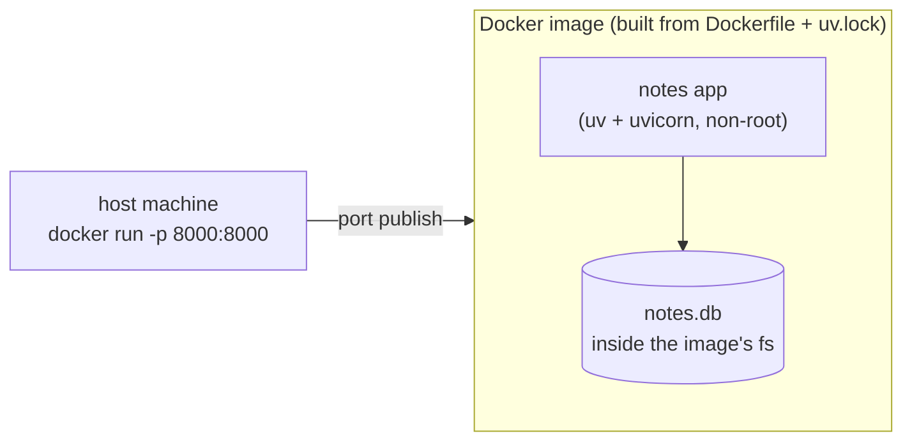

# 04 — Dockerize the app

> After this chapter you can build a container image of the app and run it
> with `docker run` — and understand exactly which layer of the image does
> what, so your builds stay fast.

## Concept

Up to here everything has run on a machine that already has Python, uv, the
right dependencies, and a database file. That's fine for *one* developer,
and it's precisely the problem for everyone else: "works on my machine" is a
feature, not a fix. A new student, a CI runner, a server, a teammate — none
of them have your environment.

**Docker** packages the app *and* its runtime into an **image**: a small,
read-only bundle of everything the app needs. Anyone with `docker` can run
the exact same code in the exact same way. The image is built once and is
reproducible — which is what ch.7's CI and ch.8's deploy are built on.

Two ideas carry this whole chapter:

- **Layered cache.** A `Dockerfile` is a stack of steps; each `RUN`/`COPY`
  is a layer. Docker remembers layers by their contents. Put the *stable*
  stuff (the lockfile + deps) low and the *churning* stuff (app code) high,
  and editing a line of Python rebuilds only the top layer — not the
  multi-hundred-megabyte dependency install.
- **Local == container.** We deliberately run the *same* uv + lockfile setup
  inside the container we use locally (`make run` vs `docker run`). If the
  two diverge, "works locally, fails in Docker" becomes a mystery you can't
  debug. One source of truth: `uv.lock`.

## What changed in this branch

| File | Change |
|------|--------|
| `Dockerfile` | New. Multi-layer image from `ghcr.io/astral-sh/uv:python3.12-bookworm`. Installs deps from `uv.lock` (cached layer), then copies the app + assets, runs as an unprivileged user, and starts uvicorn on `0.0.0.0`. |
| `.dockerignore` | New. Keeps the **build context** small and secrets/local-state out of images: `.git/`, `docs/`, `tests/`, `*.db`, `.venv/`, editor noise. |
| `Makefile` | New `make build` (tags image `notes-app`) + an overridable `IMAGE` variable. |

The Python code, templates, and `models.py` are **untouched** — that's the
point of a good Dockerfile: it wraps the app, it doesn't reach into it.

## Try it yourself

From a clean checkout of `04-docker`:

```bash
make check            # confirms docker daemon is up
make build            # docker build -t notes-app .   (first run pulls layers; later ones are fast)
make run-docker       # docker run --rm -p 8000:8000 notes-app   (builds first if needed, blocks until stopped)
```

`make run` and `make run-docker` are *deliberately different*: the first is
your dev loop (auto-reload, your local `notes.db`, edits land instantly);
the second validates the **artifact** — "would this image work on a machine
that only has docker?" That contrast *is* the chapter.

In a second terminal, hit the running container:

```bash
curl -s localhost:8000/notes -H 'Content-Type: application/json' \
     -X POST -d '{"title":"from a container","body":"docker made me"}'
curl -s localhost:8000/
curl -s -o /dev/null -w "css -> %{http_code}\n" localhost:8000/static/style.css
```

Then the lesson that makes it real — **the data is inside the container, not
on your machine**:

```bash
# (make run-docker is still blocking in the other terminal - find its container by image)
docker ps -q --filter ancestor=notes-app      # the anonymous container id
docker exec <id> sh -c 'ls -la /app/notes.db'   # your rows, on the container's filesystem
```

```bash
# stop it (Ctrl-C in the make run-docker terminal), then remove it
docker rm $(docker ps -aq --filter ancestor=notes-app | tr '\n' ' ') 2>/dev/null; true
```

Now run it again and `GET /notes` — **empty.** The rows were on the
container's *writable layer*, which is gone with `docker rm`. Stop/restart
(`docker stop` + `docker start`) keeps the layer; **removing** the
container throws it away. This is the exact problem ch.5 solves: a real
Postgres service with a named volume, so data outlives the app container.

Finally, `make test` still runs locally (pytest against the same code) —
the Docker image and the local run are the same app, just different
packaging.

## Common pitfalls

1. **`Address already in use` / `port is already allocated`** on
   `docker run -p 8000:8000`. Something (usually a *local* `make run` from
   ch.1–3, or a leftover container) is holding 8000. `make check` names the
   process + PID; stop it first. This is the single most common "Docker
   won't start."

2. **Everything rebuilds on every tiny code change** (slow `make build`).
   Means your `COPY`/`RUN` order defeated the cache — the app code sits
   *below* the dependency layer, or a `COPY . .` dumped the whole context
   before the cached steps. Check the Dockerfile order: lockfile+deps first
   (stable), `COPY notes_app/` last (churny).

3. **`.env` or `notes.db` ended up in the image.** The build context sent
   files Docker didn't want. If you add sensitive files later, add them to
   `.dockerignore` — the fix here, and the habit the ch.5 secrets story
   depends on.

4. **Container "works" but port is unreachable from the host.** A common one
   on macOS/Windows Docker Desktop: the daemon runs in a VM. If
   `localhost:8000` is dead but the container's `curl` from *inside* works,
   your `-p 8000:8000` publish is what's broken (VM port-forward), not the
   app. `docker run` with `--rm` also removes the container's filesystem on
   exit — don't use `--rm` while debugging, or you lose the logs.

5. **`notes.db` vanishing between `docker rm`** (the demo above). Not a
   bug — it's the point: app-local state that must survive needs a volume
   or a service (ch.5).

## Stretch exercise

Rebuild and measure the cache: run `make build` twice and time each, then
change **one line of `notes_app/views.py`** and rebuild again. Confirm the
third build is dramatically faster (only the app-code layer re-runs; the
hundreds of MB of dependencies are `CACHED`). Then add a brand-new
dependency (`uv add` a tiny package) and rebuild — watch the dependency
layer re-run while the base image stays cached. Write two sentences on
*why* the order in this Dockerfile is the way it is, in terms of layer
cache.

## Self-check quiz

1. What's the difference between `docker stop` + `docker start` and
   `docker rm` + `docker run` for the app's SQLite data?
2. Why does the Dockerfile install dependencies from `uv.lock` in one layer
   and copy the app code in a *later* layer, rather than `COPY . .` once
   and build everything at the end?
3. Why does `CMD` bind `--host 0.0.0.0` instead of the default `127.0.0.1`?
   What would `-p 8000:8000` do to a container listening only on loopback?
4. What is a "build context," and what two things does `.dockerignore`
   protect you from?
5. A student edits `notes_app/models.py` and runs `make build` — do the
   dependency layers re-run? Why or why not?

<details>
<summary>Answers</summary>

1. Stop/restart **keeps** the container's writable layer, so `notes.db`
   (and its rows) persist; `docker rm` **deletes** the container and its
   writable layer, so the file and data are gone. `docker run` starts a
   fresh, empty one.
2. Layer cache: the lockfile+deps layer is keyed on the *manifest*, not the
   source code, so it's reused across builds until you `uv add`. Keeping
   `COPY notes_app/` last means a code edit re-runs only that thin layer.
   One big `COPY . .` early would invalidate everything below it on any
   context change.
3. A container's own loopback is unreachable from the host or other
   containers; publishing `-p 8000:8000` forwards host:8000 to the
   container's **interface** that the app is listening on. If it only
   listens on `127.0.0.1`, the published port connects to nowhere — the
   request is dropped. `0.0.0.0` listens on all interfaces, so the
   published port works.
4. The build context is the set of files Docker sends to the daemon for a
   build (the `.` in `docker build .`). `.dockerignore` protects you from
   (a) a huge/slow context and (b) leaking local state or secrets into the
   image.
5. No — the dependency layer's key (lockfile + pyproject) is unchanged, so
   it's `CACHED`; only the `COPY notes_app/` layer and everything after it
   re-run. That's the payoff of the layer order.

</details>

## Classroom demo checklist

**Show live** (fast, satisfying, low-risk):
- `make build` first time (note the pull), second time (all `CACHED` — the
  cache *is* the lesson). ~seconds.
- `docker run` → `curl` a note in → `docker exec ... cat /app/notes.db`
  shows the rows *in the container*. Then `docker rm` → rerun → `GET /notes`
  empty. The "data died with the container" beat.
- Edit a line, `make build`, show only the app layer re-runs.

**Pre-record / screenshot** (slow or noisy live):
- The very first `docker build` layer pull (can be slow on a cold machine) —
  screenshot the `CACHED` lines, don't wait the room through it.
- `docker images` showing the image size — one screenshot, sets up the
  "keep images small" habit.

## Architecture as of this chapter

The diagram gains its first *containerized* boundary: the same app, now
packaged as an image, with its data trapped inside that package — the tension
ch.5 resolves by pulling the database out into its own service.



Next chapter (ch.5) introduces Docker Compose and a real Postgres service —
`notes.db` steps aside for a durable, shared database, and the "data outlives
the app" habit finally lands for good.
