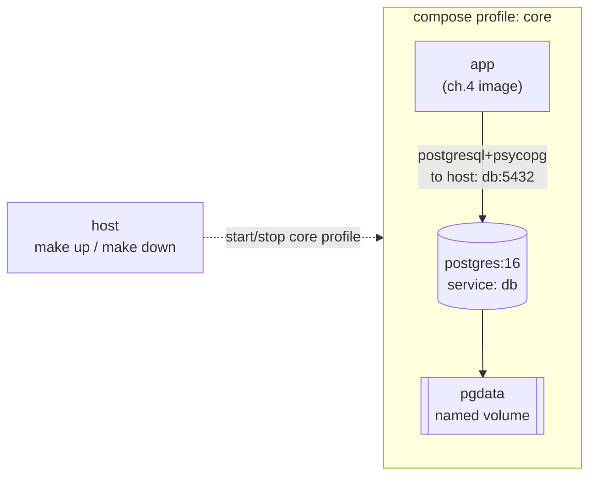

# 05 — Docker Compose + Postgres (and where secrets start to live)

> After this chapter you can bring up the whole stack — app *and* a real
> database — with one command, and you understand why the credentials for
> that database live in a `.env` file that never gets committed.

## Concept

In ch.4 the database was a **SQLite file inside the app container**. That was
the right step *for that chapter*, but it left two real problems:

- **It's not a real database server.** One process, one file, one writer.
  Two apps, or a backup, or a monitoring tool can't connect to it.
- **Data is trapped in the container.** `docker rm` and your notes are gone.

A production app splits these: the **application** and the **database are
separate, independently-running services** that find each other over the
network. **Docker Compose** is the tool that declares that whole topology —
"run the app, run Postgres, put them on one private network, wire the app
to the DB" — in a single file, and starts it all with **one command**.

Two bigger ideas carry this chapter:

- **Service discovery by name.** Inside a Compose network, services reach
  each other by their *name* (`db`, not `127.0.0.1`, not an IP). You never
  hardcode an address that will change.
- **The secrets story begins.** A real database needs credentials. This
  course's rule: **never commit a real credential.** We keep them in a
  `.env` file that is **gitignored**, and we ship only a `.env.example`
  template. A pre-commit hook + the CI stage (ch.7) catch any credential
  that slips in. This is the habit you carry into every real job.

## What changed in this branch

| File | Change |
|------|--------|
| `docker-compose.yml` | New. Two services — `app` (built from the ch.4 image) and `db` (`postgres:16-alpine`) — both in the `core` profile. `app` waits for `db` to be *healthy* (`pg_isready`), not just started. `db`'s data lives in a **named volume** (`pgdata`). |
| `notes_app/models.py` | **No logic changed** — the ch.2 seam pays off. The app just reads `DATABASE_URL`; Compose sets it to `postgresql+psycopg://…@db:5432/notes`. The only change is that a Postgres driver is now required, so `psycopg` was added to the lock. |
| `pyproject.toml` + `uv.lock` | `psycopg[binary]` (Postgres driver for SQLAlchemy) and `pre-commit` added. |
| `.env.example` / `.env` | New. The template that ships (`POSTGRES_USER/PASSWORD/DB`) vs. the gitignored file that holds *your* real values. Compose reads `.env` to fill the `${…}` interpolations in `docker-compose.yml`. |
| `.gitignore` | Now ignores `.env` — **the `.env.example` template is what commits; the real `.env` is yours.** |
| `scripts/scan-secrets.sh` | New. A secret scan (gitleaks if installed, else a regex for `user:pass@`, `sk-…`, `AKIA…`). Designed to *ignore* compose `${VARS}` but *catch* hardcoded creds. |
| `.pre-commit-config.yaml` | New. Two local hooks: run the scan, and block a commit that ever tracks a `.env`. |
| `Makefile` | New `make up` / `make down` (compose, `core` profile, auto-creates `.env` from the example) and `make scan`. |
| `docs/05-compose.md` | This file. |

New concepts named in the code: **compose service** (a named box in the
topology), **profile** (a tag so you start *some* of the stack, not all of
it), **named volume** (data that outlives any container), **healthcheck**
(the DB says "I'm ready" before the app is let near it), **interpolation**
(`${VAR}` in the compose file), and **`.env` vs `.env.example`** (secret vs
template).

## Try it yourself

From a clean checkout of `05-compose`:

```bash
make check && uv sync
make up                 # builds the app image, then starts app + postgres
```

Watch the log line **`Container ...-db-1  Healthy`** — the healthcheck
gated the app. Then:

```bash
curl -s localhost:8000/notes -H 'Content-Type: application/json' \
     -X POST -d '{"title":"in postgres now","body":"ch.5"}'
```

Now the moment that proves the data is **real and external** — read it
straight out of Postgres, not through the app:

```bash
docker compose exec db psql -U notes -d notes -c 'select * from notes'
```

And the beat that ch.4 was building to — **data now outlives the app**:

```bash
make down && make up
docker compose exec db psql -U notes -d notes -c 'select count(*) from notes'
# -> still 1. The named volume (pgdata) kept it.
```

Finally the secrets habit, on demand:

```bash
make scan              # should be clean on this repo
```

## Common pitfalls

1. **"The app started, then immediately crashed with `could not connect to
   server`."** → The app was let loose before Postgres was ready. We prevent
   this with `depends_on: db: condition: service_healthy` — not plain
   `depends_on: [db]` (which only waits for *started*, and a Postgres box
   that's "started" can still be refusing connections for a second or two).

2. **`.env` committed and pushed, with a real password.** The single most
   common secret leak. `make up` auto-creates `.env` from the example on
   first run, but the *password* in there is a placeholder — the pre-commit
   hook blocks committing `.env` itself, and `scan-secrets.sh` catches any
   credential that slips into a *tracked* file. Keep `.env` local, always.

3. **`port is already allocated` / 5432 in use.** Compose publishes Postgres
   on host `5432`. If a real Postgres is running on the host, clash.
   `make check` names the holder; either stop it or remap the port in the
   compose file (`"127.0.0.1:5433:5432"`).

4. **App can't reach DB: "db" — name resolves fine locally, fails in CI.**
   Service-name DNS only exists *on the compose network*. From the host you
   use the published port; from another container on the same network you
   use the name. Mixing those two is the classic "works on my laptop" bug.

5. **`make down` "loses" the database.** `make down` (`docker compose down`)
   stops the containers but *keeps the named volume* by default, so the data
   survives. To truly wipe: `docker volume rm devops_course_pgdata` — and
   that's a deliberate, scary act, which is the point.

## Stretch exercise

Add a **backup** service: a third `core`-profile container that, every
minute, runs `pg_dump` on the `db` and writes to a host-mounted volume. Then
add a `restore` make target that stops `db`, restores from the dump, and
starts it. Walk through it and explain, in one sentence, why you did *not*
just `pg_dump` to a file on the `db` container's own filesystem. (Hint: that
filesystem is ephemeral — the same trap ch.4 left you on purpose.)

## Self-check quiz

1. What's the difference between `depends_on: [db]` and
   `depends_on: db: condition: service_healthy`? Which one is correct for a
   database, and why?
2. Inside the compose network, what address does `app` use to reach
   Postgres? What does `db` use to reach `app`?
3. Why is `.env` gitignored but `.env.example` committed? What would the
   team lose if we committed `.env` instead?
4. `make down` then `make up` — does the `notes` table still have its row?
   Where did that data live while the container was gone?
5. The regex in `scan-secrets.sh` deliberately ignores `${POSTGRES_USER}`
   but flags a hardcoded username:password inside a connection string
   (like one you accidentally pasted into code or docs). Why is that the
   *right* behavior for a scanner to have?

<details>
<summary>Answers</summary>

1. Plain `depends_on` only orders *start*; it fires the moment the container
   is up, not when the app inside is accepting connections. `service_healthy`
   waits on the healthcheck (`pg_isready`) so the app only starts when the DB
   is actually reachable. For a database, the latter is the correct one.
2. `app` reaches Postgres at `db` (the compose service name). `db` has no
   route to `app` — the DB is passive; only the app connects to it. (If you
   needed the reverse you'd give `app` a published port on the network.)
3. `.env` holds **your** real credentials — committing it ships them to
   everyone who clones. `.env.example` holds **placeholders** so anyone can
   build a working `.env` in one `cp`. Committing `.env` is the leak the
   hook exists to stop.
4. Yes. The row lived in the **named volume** `pgdata` (a host-managed
   directory), not on the container's ephemeral layer. `docker compose down`
   removes containers but not named volumes.
5. `${POSTGRES_USER}` is a *reference to a secret*, not a secret — its value
   lives in the local `.env`, which never ships. A hardcoded
   `bob:hunter2@` is a secret that *would* ship in the image/repo. Flagging
   the reference would make students distrust a tool that cries wolf;
   flagging the real credential is the value.

</details>

## Classroom demo checklist

**Show live** (fast, satisfying, low-risk):
- `make up` — point out the **`db  Healthy`** line before `app` starts.
- `curl` POST a note → `docker compose exec db psql … select *` shows it in
  a *real* database. The "it's not a file anymore" beat.
- `make down && make up` → the row is still there. The data-outlives-app
  beat.
- `make scan` clean → then `make scan` against a file with a hardcoded
  credential → it fires. The secrets habit in ~20 seconds.

**Pre-record / screenshot** (slow or noisy live):
- The first `make up` build of the app image (pull layers on a cold machine)
  — screenshot the `Healthy` lines, don't wait the room through it.
- `docker compose exec db psql` output showing the table — one screenshot
  proves "real database" better than live scrolling.

## Architecture as of this chapter

The ch.4 single-box-with-a-file becomes a **two-service topology**: the app
and a dedicated database, on one private network, data on a named volume.
This is the shape every later chapter (CI ch.7, observability ch.11–13)
builds *around* — they add more boxes; these two stay the core.



Next chapter (ch.6) adds structured logging to the *same* two services — no
topology change, the diagram shape holds; ch.7 adds Jenkins as a third box.
