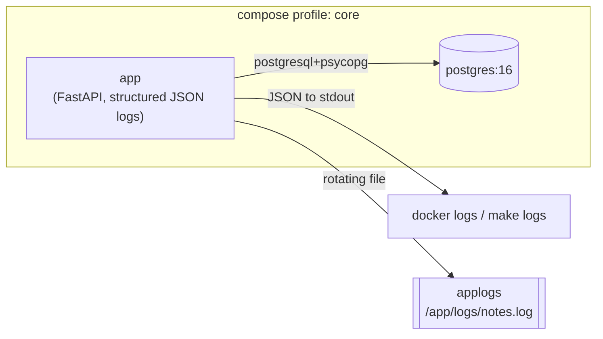

# 06 — Structured logging (JSON logs + rotation)

> After this chapter you can make your app emit **machine-readable** logs
> (one JSON object per line, on stdout *and* a rotating file), read them
> with `docker logs`, and explain why that format is the difference between
> "eyeballing a wall of text" and "querying what happened."

## Concept

Since ch.1 the app has been *un*observable: when something goes wrong in a
container at 3am, the only log is whatever `uvicorn` decided to print, in
whatever shape it chose. Worse, human-shaped log lines (`"2026-10-28 INFO
note created id=3"`) are exactly what breaks in production: you can't
`grep` a structured field, a log shipper can't turn it into a queryable
document, and "was this note created *for user 42*?" becomes an art form.

**Structured logging** flips that: every log event is a **JSON object**, one
per line:

```json
{"time": "2026-10-28T16:56:43Z", "level": "INFO", "logger": "notes_app", "message": "note created", "event": "note_created", "note_id": 3}
```

Now every field is queryable — by `jq` on the terminal, by `docker logs`
pipelines, and (ch.13) by SigNoz's log receiver, which turns each object
into a searchable record. The format you pick **today** is the format the
whole observability arc of this course builds on.

Two concepts land together, and you'll recognize both from later chapters:

- **Log to stdout.** A container's contract with the world is its two
  pipes. The orchestrator (Docker, K8s) captures stdout; you never scp into
  a box to read logs. So the app's primary sink is `stdout`, not a file.
- **Rotation.** A file sink (kept as the "grep on disk" fallback) is capped
  — 5 MB, keep 3 backups — so a chatty app can never fill the disk. This is
  the same *bound your resources* instinct as ch.4's layering and ch.5's
  profiles.

And one more, quietly: **the ch.2 seam pays off again.** Logging is
configured in *one module* (`logging_config.py`) and turned on with *one
call* in `main.py` — so ch.10 adding `trace_id` is a one-line change, not a
rewrite.

## What changed in this branch

| File | Change |
|------|--------|
| `notes_app/logging_config.py` | New. Owns the *shape* and *destination* of logs: a `JsonFormatter` (one JSON object per line), a stdout handler, and a **`RotatingFileHandler`** (5 MB cap, 3 backups). Reads `LOG_LEVEL` / `LOG_FILE` from the environment. |
| `notes_app/main.py` | One call at startup: `setup_logging()`. |
| `notes_app/views.py` | The two business events ("note created", "note deleted") now emit structured logs with queryable fields (`event`, `note_id`, `title`). |
| `docker-compose.yml` | `app` gets `LOG_FILE=/app/logs/notes.log` and a **named volume `applogs`** at `/app/logs` — the "state outlives the container" rule from ch.4/5, applied to logs. |
| `Dockerfile` | Pre-creates `/app/logs` **owned by the app user** (ch.4's non-root habit meets the ch.6 volume — see pitfall #1, a real `PermissionError`). |
| `Makefile` | New `make logs` (`docker compose logs -f app`) — the command the whole observability habit revolves around. |
| `tests/test_logging.py` | New. The *contract* test: after a request, **every** line in the log file parses as JSON and carries the expected keys. |

New concepts named in the code: **structured/JSON log line** (one object, one
line — newlines are event boundaries), **stdout as the primary sink**,
**`RotatingFileHandler`** (size cap + backup count), **log level**
(`LOG_LEVEL`), and the **log file on a volume** (so a `docker rm` / redeploy
doesn't silently eat your history — ch.13 will *ship* this file into SigNoz).

## Try it yourself

From a clean checkout of `06-logging`:

```bash
make check && make up          # brings app + postgres up (ch.5)
make logs &                    # terminal 2: follow the app's JSON logs
```

In terminal 1, hit the API and watch *structured* lines stream in terminal 2:

```bash
curl -s localhost:8000/notes -H 'Content-Type: application/json' \
     -X POST -d '{"title":"logged","body":"watch terminal 2"}'
```

You should see a `"note created"` object with `"event":"note_created"` and a
`note_id` — not a prose sentence. Now the machine-readable payoff:

```bash
# filter to *our* events only, one clean field, no regex gymnastics:
docker compose --profile core logs app | grep 'note_created'
```

And the rotating file on the volume (the "grep on disk" fallback):

```bash
docker compose exec app ls -la /app/logs
docker compose exec app tail -5 /app/logs/notes.log
```

Then the contract test — the thing that makes "every line is JSON" a rule
the CI enforces, not a hope:

```bash
make test        # test_logging.py asserts each log line json.loads()s
```

## Common pitfalls

1. **`PermissionError: [Errno 13] /app/logs/notes.log` on first `make up`
   with a fresh `applogs` volume.** → A brand-new named volume is seeded from
   the image path and is owned by **root**; but the app runs as the
   unprivileged `courseuser` (ch.4's habit). Fix: the Dockerfile pre-creates
   `/app/logs` **and** `chown`s it to the app user *before* the volume is
   attached, so the seed inherits the right owner. If you still hit it (an
   existing root-owned volume from before the fix), `docker volume rm
   devops_course_applogs` and `make up` again. *This exact error is what
   "non-root user" + "named volume" produces together* — a one-off in ch.4
   that only shows up when a volume is introduced in ch.6.

2. **Logs are prose, not JSON — `docker logs` is a wall of text.** That's
   the *default* Python logging output; it means `setup_logging()` didn't
   run. It's called in `main.py` (the entry point uvicorn/compose import);
   if you launched the app a different way (a custom runner that imports
   `views` directly, say), the root logger never got the `JsonFormatter`.

3. **Two identical lines per event.** `setup_logging()` wipes the root
   logger's default handlers before adding its own; a re-import that *also*
   attaches handlers double-logs. (The `propagate = False` on the uvicorn
   loggers is the same instinct — stop the record climbing the tree twice.)

4. **Multi-line records glue two events together.** The JSON formatter emits
   *one* line per event by design. A pretty-printed or multi-line log record
   makes `docker logs` / a collector treat two events as one. If you ever
   log an exception, it lands in the `exc_info` field *of the same object*
   — never as a separate unjoined line.

5. **`logs/` or the volume growing unbounded.** The local default writes
   `logs/notes.log` (gitignored) and the container writes the `applogs`
   volume — both rotate (5 MB × 3). "Log files eat the disk" is solved by
   rotation; the *shipping* of logs to a real store is ch.13's job.

## Stretch exercise

Make the *rotation itself* observable: set `LOG_FILE` to a path, then in the
container run the app with a tiny `maxBytes` (e.g. point `ROTATE_BYTES` at
a few KB via an env var you add) and hammer `/notes` until you see
`notes.log`, `notes.log.1`, `.2`, `.3` appear with the oldest deleted.
Explain in one sentence why `backupCount` + `maxBytes` together guarantee the
directory's disk usage stays bounded no matter how chatty the app is.

## Self-check quiz

1. Why is "one JSON object per line" a *requirement* for log collection,
   not a style preference? What breaks if a record spans two lines?
2. Why does the container write its log file to a **named volume** instead
   of just the container's own filesystem? (Recall ch.4's "data died with
   the container.")
3. What's the difference between the **stdout** sink and the **file** sink,
   and which one does `docker logs` actually read?
4. `RotatingFileHandler` is set to 5 MB / 3 backups. In the worst case,
   roughly how much disk can the log *directory* occupy, and why does it
   never exceed that?
5. ch.10 will add `trace_id` to every log line. Where in this chapter's code
   does that change actually live, and why is that a good thing?

<details>
<summary>Answers</summary>

1. Log collectors and `docker logs` treat **newlines as event
   boundaries**. A pretty-printed or multi-line record makes two events
   look like one (the first line parses, the rest are orphaned), corrupting
   the stream. One object per line is the unit of "a thing happened."
2. A container's filesystem is **ephemeral** — `docker rm` / a redeploy
   discards it. A named volume is host-managed and outlives the container
   (the ch.4/5 "data outlives the app" rule), so a restart doesn't eat the
   log history.
3. The **stdout** sink is what the orchestrator captures — that's the
   stream `docker logs` / `make logs` shows. The **file** sink is a
   disk-backed fallback for grepping in place. In this app both get the
   same JSON shape; in production the file sink is often dropped entirely
   and the stdout is shipped to a log store instead (ch.13).
4. `(5 MB × 3 backups) + 5 MB active = ~20 MB`, *always*. `RotatingFileHandler`
   rolls `notes.log` → `.1` → `.2` → `.3` and **deletes the oldest** past
   `backupCount`, so total usage is bounded by the knobs, independent of
   how long or chatty the app runs.
5. It lives in **`JsonFormatter.format`** (and, if you want it on the
   business events, the `extra=` fields in `views.py`) — *one* place. The
   formatter already emits "our attached fields ride along" via
   `record.__dict__`, so ch.10's `trace_id` is a new key, not a new
   pipeline. That's the whole point of isolating log *shape* in one module.

</details>

## Classroom demo checklist

**Show live** (fast, satisfying, low-risk):
- `make logs &` in one terminal, `curl` a note in the other — the JSON
  `"note created"` object streaming. ~15 seconds, the "machine, not words"
  beat.
- `docker compose logs app | grep note_created` — *filtering a field*, the
  payoff of structured. One line.
- `make test` — the contract test that asserts every line parses.

**Pre-record / screenshot** (slow or noisy live):
- The `PermissionError` (pitfall #1) *and* its fix — it's a great "why
  non-root + volume breaks" story, but reproducing it live is fiddly; one
  screenshot of the traceback + the Dockerfile `chown` tells it better.
- `ls -la /app/logs` showing `notes.log` **and** a `.1`/`.2` after a
  rotation — the rotation beat, one image.

## Architecture as of this chapter

The two-service ch.5 topology gains a **third artifact**: the app's log
file, on its own volume, feeding (today) `docker logs` and (ch.13) the
SigNoz log receiver. No new *service* yet — just the app talking to a
machine-readable stream.



Next chapter (ch.7) adds **Jenkins** as a service to this compose file and
wires the *same* `make lint` / `make test` / build into a pipeline — the
logging shape you just established is exactly what CI (and later,
observability) will consume.
