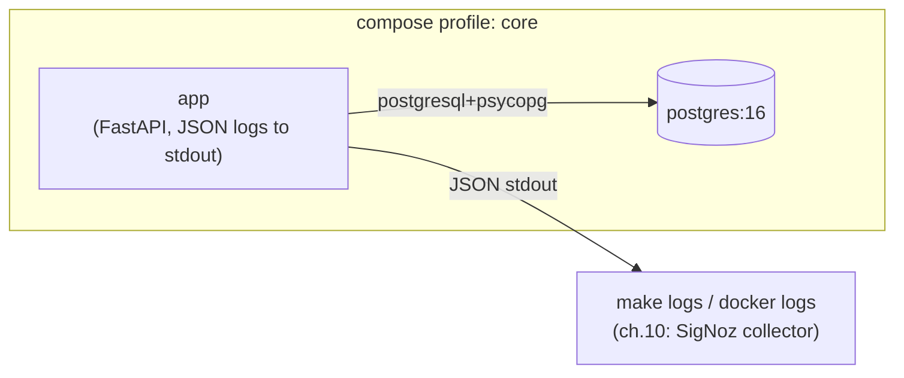

# 06 — Structured logging (JSON on stdout)

> After this chapter you can make your app emit **machine-readable** logs —
> one JSON object per line, on stdout — and read them with `docker logs`.

## Concept

Since ch.1 the app has been nearly *un*observable: when something goes wrong
in a container, the only log is whatever `uvicorn` printed, in whatever
shape it chose. And human-shaped log lines (`"2026-10-28 INFO note created
id=3"`) are exactly what breaks in production: you can't `grep` a structured
field, and "was this note created?" becomes an art form.

**Structured logging** flips that: every log event is a **JSON object**, one
per line:

```json
{"time": "2026-10-28T16:56:43Z", "level": "INFO", "logger": "notes_app.views", "message": "note created", "event": "note_created", "note_id": 3}
```

Now every field is queryable — by `jq` on the terminal, and (ch.10) by
SigNoz's log receiver. The format you pick **today** is what the whole
observability arc builds on.

Two ideas carry this chapter, both small on purpose:

- **One JSON object per line.** Log collectors (and `docker logs` itself)
  treat a *newline* as an event boundary. Pretty-printed, multi-line logs
  glue two events into one and corrupt the stream. One line, one event.
- **A container's only "file" is its stdout pipe.** The orchestrator
  (Docker) captures the container's two pipes; you never `scp` into a box
  to read logs. So the app logs to **stdout**, and `docker logs` /
  `make logs` is how you read it. That's it — no log files, no rotation.
  (Real log *shipping* to a store is ch.10's job, and it ships *this*
  stream.)

And one quiet payoff: logging is configured in **one small module** and
turned on with **one call** in `main.py`, so ch.9 adding `trace_id` is a
one-line change, not a rewrite.

## What changed in this branch

| File | Change |
|------|--------|
| `notes_app/logging_config.py` | New, and small on purpose: a `JsonFormatter` (one JSON object per line) and `setup_logging()` that points the root logger — and uvicorn's access/error loggers, so *request* lines have the same shape — at **stdout**. Reads `LOG_LEVEL` from the environment. |
| `notes_app/main.py` | One call at startup: `setup_logging()`. |
| `notes_app/views.py` | The two business events ("note created" / "deleted") now log through the controller's `logger`, with queryable fields in `extra=` (`event`, `note_id`). |
| `docker-compose.yml` | `app` gets `LOG_LEVEL: INFO` — behavior from the environment, the ch.5 habit. |
| `Makefile` | New `make logs` (`docker compose logs -f app`). |
| `tests/test_logging.py` | New. The *contract* test: capture what the app writes to stdout and assert **every** line `json.loads()s`. |

New concepts named in the code: **structured/JSON log line** (one object,
one line), **stdout as the container's log stream**, **`extra=` fields**
(carrying queryable data into a log record), and **uvicorn's `uvicorn.access`
logger** (the one that prints HTTP request lines — re-pointed at the same
handler so the whole stream has one shape).

## Try it yourself

From a clean checkout of `06-logging`:

```bash
make check && make up          # brings app + postgres up (ch.5)
make logs &                    # terminal 2: follow the app's JSON logs
```

In terminal 1, hit the API and watch *structured* lines stream in terminal 2:

```bash
curl -s localhost:8000/notes -H 'Content-Type: application/json' \
     -X POST -d '{"title":"logged","body":"watch terminal 2"}'
```

You'll see a `"note created"` object with `"event":"note_created"` and a
`note_id` — not a prose sentence. The machine-readable payoff:

```bash
# filter to *our* events only, one clean field, no regex gymnastics:
docker compose --profile core logs app | grep 'note_created'
```

Then the contract test — the thing that makes "every line is JSON" a rule
CI enforces, not a hope:

```bash
make test        # test_logging.py asserts each stdout line json.loads()s
```

## Common pitfalls

1. **`docker logs` is a wall of prose, not JSON.** The app fell back to
   Python's *default* log format — which means `setup_logging()` didn't run.
   It's called in `main.py` (the entry point uvicorn/compose import). If you
   launched the app some other way (a custom runner that imports `views`
   directly), the root logger never got the `JsonFormatter`.

2. **Two identical lines per event.** `setup_logging()` *replaces* the root
   logger's handlers (it doesn't append) and sets `propagate = False` on the
   uvicorn loggers — both so a record is emitted exactly once. Re-importing
   the app, or a handler left on *both* a child and the root, is how you
   get the doubling.

3. **Multi-line records gluing two events together.** The JSON formatter
   emits *one* line per event on purpose. A pretty-printed record makes
   `docker logs` / a collector treat two events as one. If you ever log an
   exception, it lands in the `exc_info` field *inside the same object* —
   never as separate unjoined lines.

4. **Logging to a file "for safety."** Tempting, and the wrong move for a
   container: a file the container writes to its own ephemeral layer van
   isn't read by `docker logs`, dies with the container, and is exactly the
   "state trapped in the box" problem ch.4/5 solved for *data*. Logs are the
   same kind of thing: keep them on stdout; *shipping* them somewhere durable
   is ch.10's job.

## Stretch exercise

Add a second queryable field end-to-end: log the HTTP **method + path** for
each request (you'll need a middleware, or to read it from the uvicorn
access log). Then `docker compose logs app | jq '.method'` and explain in
two sentences why adding that field required touching *only* the formatter's
`_FIELDS` list plus one `extra=` value — not the pipeline, not `make logs`.

## Self-check quiz

1. Why is "one JSON object per line" a *requirement* for log collection,
   not a style choice? What breaks if a record spans two lines?
2. Why does a container's app log to **stdout** rather than a file? What
   does `make logs` actually read?
3. How do the queryable fields (`event`, `note_id`) get *into* a JSON line
   without rewriting the formatter for every new field? (Hint: `extra=`.)
4. Why is `propagate = False` set on `uvicorn.access` *and* the handler
   list replaced on the root logger — what's the symptom if you get either
   wrong?
5. ch.9 will add `trace_id` to every line. Where does that change live, and
   why is this design a good thing for that moment?

<details>
<summary>Answers</summary>

1. Collectors and `docker logs` treat **newlines as event boundaries**. A
   record spanning two lines makes the first line parse and the second an
   orphan — two events look like one, corrupting the stream. One object per
   line is the unit of "a thing happened."
2. A container's only pipes are its two stdout streams; the orchestrator
   captures them and that's the stream `docker compose logs` / `make logs`
   reads. A file on the container's own filesystem is invisible to `docker
   logs` and dies with the container — wrong tool for logs.
3. You pass `extra={"event": "note_created", "note_id": 3}` to the logger;
   the formatter already knows to lift the named fields in `_FIELDS`
   (`event`, `note_id`, …) off the record into the JSON. A *new* field is
   one more name in `_FIELDS` — no pipeline change.
4. Both stop **double-logging**. `uvicorn.access` is a *child* of the root
   logger; without `propagate = False`, each access record emits through the
   child's handler *and* again through the root's. And replacing (not
   appending) the root's handler list prevents a re-import from adding a
   second stdout handler. Symptom if either's off: two identical lines per
   event.
5. It lives in **`logging_config.py`**: add `"trace_id"` to `_FIELDS` (or
   have the middleware attach it via `extra=`), and it appears on every line
   automatically. That's the whole payoff of isolating log *shape* in one
   small module — the observability chapters build on it without re-plumbing.

</details>

## Classroom demo checklist

**Show live** (fast, satisfying, low-risk):
- `make logs &` in one terminal, `curl` a note in the other — the JSON
  `"note created"` object streaming. ~15 seconds, the "machine, not words"
  beat.
- `docker compose logs app | grep note_created` — *filtering a field*, the
  payoff of structured. One line.
- `make test` — the contract test that asserts every stdout line parses.

**Pre-record / screenshot** (slow or noisy live):
- The *default* (prose) log vs the JSON log side by side — one screenshot
  tells the "why structured" story better than live scrolling.
- `jq`'ing a field out of `docker compose logs app` — the "queryable" beat,
  one image.

## Architecture as of this chapter

The two-service ch.5 topology gains a **machine-readable stream**, not a new
service: the app's structured logs ride its stdout pipe to `docker logs` /
`make logs` today, and to SigNoz's collector in ch.10.



Next chapter (ch.7) adds **Jenkins** to this compose file and wires the
*same* `make lint` / `make test` / build into a pipeline — the log shape you
just established is exactly what CI (and later observability) will consume.
