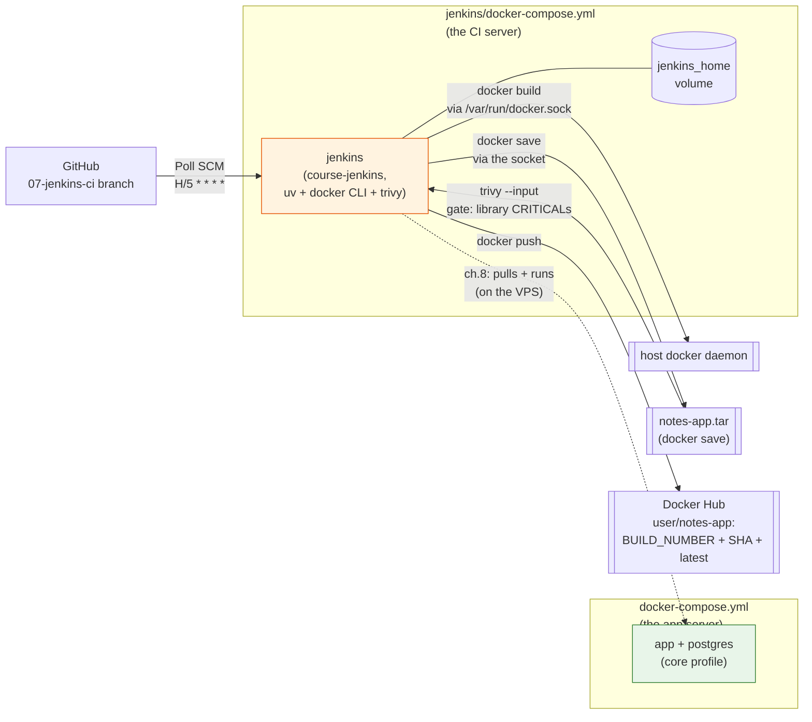

# 07 — Jenkins CI pipeline (in Docker)

> After this chapter, **a push to GitHub makes a machine rebuild the image**.
> No button, no SSH, no human: the pipeline checks out the code, runs your
> exact `make lint` / `make test` / build, gates the image through
> Trivy's CVE scan, and pushes it to Docker Hub.

## Concept

CI = *the same commands a developer runs, run by a machine, on every commit*.
The whole pipeline is a `Sync` step, three checks that run **in parallel**
(Lint · Scan · Test), the image build, the Trivy gate, and the push — plus a
`post` block. And the honesty is the point:

| Step | Command | Where you already ran it |
|-------|---------|--------------------------|
| Lint | `uv run ruff check . && ruff format --check .` | `make lint` (ch.1) |
| Scan | `bash scripts/scan-secrets.sh` | `make scan` + pre-commit (ch.5) |
| Test | `uv run pytest -q` | `make test` (ch.2) |
| Build | `docker build -t notes-app .` | `make build` (ch.4) |
| Gate | `trivy image --input … --pkg-types library --severity CRITICAL --exit-code 1` (new) | — |
| Push | `docker login` + `docker push` (new) | — |

(Lint, Scan and Test are three `parallel` sub-stages under one `Checks`
stage — independent checks don't need to wait for each other.)

If CI is red, the mistake is one you could have made yourself; the pipeline
just refuses to ship it.

Three ideas carry this chapter:

- **The pipeline lives in a container, on the host daemon.** The `docker build`
  stage runs *inside* the Jenkins container but drives the *host's* Docker
  daemon through a mounted socket (`/var/run/docker.sock`). That's the gotcha:
  no Docker-in-Docker, no second daemon — the image that the pipeline builds
  is the one on your `docker images`. One bridge, one line to explain.
- **The trigger is owned by the repo, not the UI.** The `triggers` block in
  the Jenkinsfile writes `Poll SCM H/5 * * * *` into the job on every build.
  After that, Jenkins asks GitHub *"did the branch move?"* every
  ~5 minutes; a pushed commit starts a build on its own. Local edits don't
  fire it — the poller compares the **remote tip**, not your disk.
- **It's a *declarative* pipeline — and that's load-bearing.** `options` and
  `post` are declarative-only keywords and are only legal *inside* a
  `pipeline {}` body. Writing them inside a scripted `node {}` block compiles
  to nothing and the build dies with `No such DSL method 'options'` (pitfall
  #10) — the exact shape this branch's first draft shipped, caught by the
  first poll-fired build.
- **A gate is only useful if it goes green.** The Trivy stage fails the
  build on a *CRITICAL* CVE in a *library we ship* — not on the whole
  image's OS layer (the base image carries ~2000 of its own CVEs; a gate
  that's red on every build teaches students to delete it). The lesson:
  scope the gate to what a commit is actually responsible for.

And one quiet payoff: everything about *how* the pipeline is triggered and
*what* it does is now text in the repo — the Jenkinsfile is the single source
of truth you can read, diff, and review like any other code.

## What changed in this branch

| File | Change |
|------|--------|
| `Jenkinsfile` | New. A **declarative** pipeline: `triggers` (installs the Poll SCM trigger) + `options` + `Sync`, parallel `Checks` (Lint/Scan/Test), Build, Trivy Gate, Push — plus a `post` block. `agent any` means "run on the **controller** itself"; no agents, no DinD. |
| `jenkins/Dockerfile` | New. `FROM jenkins/jenkins:2.580.2-lts` + three tools the stock image lacks: `uv` (Lint/Test), the `docker` CLI (Build/Push), and `trivy` (the image gate). The base is the real Docker Hub image; plugins are *not* baked in — that's the one-time first-run step. |
| `jenkins/docker-compose.yml` | New. The **CI server as its own compose project** — `jenkins` service building `course-jenkins` (its sibling `jenkins/Dockerfile`), named `jenkins_home` volume, host socket mounted, `user: "0"`, port 13000. `name: devops_course` pins the project name so the volume keeps its prefix. One file = one machine: the root `docker-compose.yml` is the "app server", this is the "CI server" — ch.8's "move Jenkins to a VPS" is now *ship this one folder*. |
| `docker-compose.yml` | ch.7's jenkins service **removed**: two machines, two projects. A comment now points to `jenkins/docker-compose.yml`. |
| `Makefile` | New `make pipeline`: boots Jenkins and prints the one-time setup. |
| `README.md` | Branch-map row + ch.7 architecture snapshot. |

New concepts named in the code: **Poll SCM** (tip comparison against the
remote, `H/5 * * * *`), **the declarative `triggers` block** (job config
written *by* the pipeline — the modern replacement for the scripted
`properties` step), **`withCredentials` / `--password-stdin`** (secret
injected for one block, masked in logs, never on the command line),
**build-number + git-SHA tags** (`notes-app:6` *and* `notes-app:3f81c0a`
are the same commit), **`post` hooks** (`success`/`always`/`failure`
lifecycle actions), and the **Trivy image gate** (a scan that fails the
build on a critical vuln in a library *we ship* — scoped so it can actually
go green).

## Try it yourself

From a clean checkout of `07-jenkins-ci`:

```bash
make pipeline        # builds course-jenkins, boots Jenkins on :13000
```

Wait for "Jenkins is fully up and running", then open
`http://localhost:13000`. The **one-time setup** (takes ~5 minutes; the named
volume keeps it, so you never repeat it):

1. **Run the setup wizard** — at the "install suggested plugins" step, accept
   the defaults. That installs everything the pipeline uses: `git`,
   `workflow-aggregator` (the whole pipeline family), `credentials-binding`.
   The pipeline is **declarative** (`pipeline {}` with `options` / `post`
   blocks), so make sure the **`Pipeline: Declarative`** plugin is in there —
   it is, by default, but a manual minimal install can omit it, and a missing
   one is exactly the `No such DSL method 'options'` of pitfall #10.
2. **Add the registry credential** — Manage Jenkins → Credentials → System →
   Global credentials → Add credentials: kind *Username with password*,
   **ID `docker-hub`** (fill this field!), your free Docker Hub account.
3. **Create the job** — New Item → `notes-pipeline`, type *Pipeline*.
   Definition: *Pipeline script from SCM*, Git, URL
   `https://github.com/<you>/devops-course.git`, branch `origin/07-jenkins-ci`.
4. **Build now** — `Sync` → `Checks` (Lint · Scan · Test in parallel) →
   `Build image` → `Gate` → `Push`, then green.

   The Gate stage's first run takes a few extra minutes (Trivy downloads
   its vulnerability database once; the volume caches it for every later
   build).

After build #1, the trigger is live: make a trivial commit, `git push`, and
within ~5 minutes build **#2 appears started by "an SCM change"** — you
pressed nothing. Verify the artifacts:

```bash
docker images notes-app                # host image, rebuilt by the pipeline
# Docker Hub dashboard: amanupadhyay/notes-app, tags 2, a git SHA + latest
```

## Common pitfalls

1. **`docker build` "works" but the image isn't in `docker images`.**
   Check the socket mount: `- /var/run/docker.sock:/var/run/docker.sock` in
   the compose file. Without it, the container's CLI has no daemon to talk
   to. (No Docker-in-Docker, no second daemon — that's the design.)

2. **Pipeline dies on the trigger with `Invalid input: "H/5"`.** `H/5` is
   the *UI preset* shorthand; the `triggers` block (declarative) or the
   `properties` step (scripted — the old spelling) hands the string to the
   real cron parser, which wants all five fields: `pollSCM('H/5 * * * *')`.
   (The `H` hashes the offset per job, so a class full of Jenkins boxes
   doesn't all poll GitHub at second 0 of the same minute.)

3. **The poll "doesn't fire" after a commit.** It polls the **remote tip**.
   `git commit` without `git push` changes nothing from Jenkins's point of
   view. And `H/5 * * * *` means "offset within each 5-minute window" — a
   push can wait up to ~5 minutes, by design.

4. **`Could not find credentials entry with ID 'docker-hub'.** The ID is a
   **string contract** between the UI and the Jenkinsfile. Leave the ID field
   blank and Jenkins stores the entry under a random UUID — the pipeline
   still looks for `docker-hub` and fails in one clean line, deep in a green
   pipeline. This is why the ID is pinned in the docs and the Makefile hints.

5. **`docker login` asks for a password inside a pipeline.** Don't — that's
   what `withCredentials` + `--password-stdin` replaces. If you ever see
   `auth failed` from a student, the credential is private-scope or
   a wrong ID, not the password format (a *refresh token* from Docker Hub
   Settings → Security works and is the better choice).

6. **First build hangs cloning GitHub mid-transfer** (`RPC failed; curl 56
   GnuTLS recv error`). Transient network blip, not a config problem —
   re-click Build now. (If it recurs on a specific link, that link is the
   lesson.)

7. **Trivy can't see the image the pipeline just built.** The socket mount
   gives the *CLI* the host daemon — but `trivy image notes-app` runs its
   own scanner, which has its own (empty) image store, so it reports the
   image "not found". The bridge: `docker save notes-app -o …tar` through
   the host CLI, then `trivy image --input …tar` — no second daemon, no
   DinD. (Verified empirically: pointing Trivy at a bare image name inside
   the controller fails to find it; the same scan on the tarball works.)

8. **A "gate" that is red on every build gets deleted by day three.**
   A full-image `--severity HIGH,CRITICAL` scan of our image reports ~2000
   findings — almost all of them OS-layer CVEs in the uv base image,
   none of which *our commit* is responsible for. The gate we ship is
   scoped: `--pkg-types library --severity CRITICAL` — any CRITICAL in the
   Python libraries we ship fails the build (fixed or not); the OS layer's
   inherited debt is the base image's problem, not the commit's.
   (The next ratchet, when you have room in the budget: also fail on
   HIGH — today that catches 3 fixable starlette CVEs, so the ratchet is
   "update FastAPI, then flip the flag".) The rule: a gate fails on
   *introduced* debt, not inherited debt — otherwise it stops being a
   gate and becomes noise.

9. **`--exit-code 0` is not a gate; `--exit-code 1` is.** Trivy's exit
   code defaults to 0 even with findings present — without `--exit-code 1`
   the stage prints a report and the build stays green while a critical
   CVE ships to the registry. (`--exit-code 0` reads like "fail on
   anything" but means "exit with 0 regardless of findings" — the flag
   value is the exit code to *use when findings match*, not a threshold.)

10. **Pipeline dies at the top with `No such DSL method 'options'` (or
    `'post'`).** Two causes, in the order we hit them:
    (a) *mixed DSL* — `options`/`post` are **declarative-only** keywords, so
    they must live inside a `pipeline { }` body. Drop them into a scripted
    `node { }` block and the resolver can't find them; the fix is
    `pipeline { agent any ... }`, not "install more of the same plugin".
    (b) *the declarative plugin is absent* — the keywords above only exist
    if the `Pipeline: Declarative` plugin is installed; a minimal manual
    install skips it. In the stock setup (setup wizard's suggested
    plugins) it's already there, so (a) is the one that bites in practice.
    The error lists every DSL step it *does* know — `options` is missing
    from that list, and that's the tell.

## Stretch exercises

**1. Ratchet the gate.** The shipped gate fails on any *CRITICAL* CVE in the
Python libraries we ship. Turn it into a real ratchet: (a) run the gate with
`--severity HIGH` and see it go red on the current FastAPI pin — the 3
starlette findings; (b) update the pin (`uv add 'fastapi>=<new>'` +
`uv lock` + commit — the whole pipeline is now the acceptance test for the
bump); (c) flip the gate to `--severity HIGH,CRITICAL` and prove the same
stage now passes in *both* directions — it fails when the debt is real,
passes when you've paid it down.

**2. Webhook instead of poll.** GitHub repo → Settings → Webhooks → add a
*generic* webhook (POST, JSON) pointing at Jenkins's `http://<jenkins-host>:13000/github-webhook/`
(the GitHub plugin's hook endpoint), and delete the `pollSCM` line.
Same pipeline, one round trip instead of up to five minutes. Then, in one
sentence each, say: (a) why a *secret token* makes this the production
shape, and (b) why the poll still has a job in the world (the poll is the
"GitHub goes down / webhook lost" backstop — run both, cost of five lines).

## Self-check quiz

1. Why does the pipeline run on the **controller** (`agent any`) rather than
   on a separate agent, and what three tools did we have to add to the
   controller image because of that?
2. `H/5 * * * *` — what does the `H` do, and why is that good for a class
   where every student's Jenkins polls the same GitHub?
3. A student commits, pushes, and waits 10 minutes: no new build. Name the
   three most likely causes, each fixable in under a minute.
4. Why does the Push stage use `--password-stdin` instead of a flag, and why
   does `docker login` survive container rebuilds?
5. Why does the Trivy gate scan `--pkg-types library` instead of the whole
   image — and what single flag makes it a *gate* rather than a report?
6. In ch.8, the VPS deploy will `docker pull` the image this stage pushed.
   What property of the `notes-app:<BUILD_NUMBER>` tag makes "which commit is
   running in production?" a one-answer question?

<details>
<summary>Answers</summary>

1. One machine, no agent infrastructure to learn — `node` = "the Jenkins
   container itself". Three tools the stock image lacks: **`uv`** (Lint/Test
   need the same interpreter + tooling as the app image, ch.4), the
   **`docker` CLI** (Build/Push drive the host daemon through the socket),
   and **`trivy`** (the Gate stage reads the built image's libs and fails
   the build on a critical vuln we shipped).
2. `H` randomizes the *offset within the unit* per job — job A might poll at
   0–4, job B at 3–7 of each 5-minute window. A class of students polling the
   same GitHub at the same second becomes a thundering herd; hashed offsets
   spread it. The 5-minute *granularity* is unchanged.
3. (a) commit but forgot `git push` — the poll watches the remote tip;
   (b) the trigger never installed — run a build once (the `properties` step
   writes it) or set Poll SCM in the job's UI; (c) network blips swallowed
   the poll — a later window catches up, or Build now proves the pipeline
   itself is fine.
4. A password on the command line shows up in `ps` and in logs; stdin keeps
   it off both. The docker CLI reads its auth from `~/.docker/config.json` —
   and this container's `HOME` is `/var/jenkins_home`, i.e. the named volume —
   so the login persists across rebuilds.
5. `--pkg-types library` scopes the gate to the dependencies the commit
   ships, not the base image's ~2000 inherited OS CVEs (a gate that's red on
   every build gets switched off; inherited debt isn't this commit's). The
   flag that turns a *report* into a *gate* is `--exit-code 1` — without it
   Trivy exits 0 even with findings, so the build would stay green while a
   critical vuln still shipped.
6. Build number = commit: stage 1 checks out one commit and runs; the image
   is tagged with that build's number, so `notes-app:6` *is* commit #6's
   tree. `latest` moves; the number doesn't — pin deploys to the number.

</details>

## Classroom demo checklist

**Show live** (fast, satisfying, low-risk):
- The poll firing: push a trivial commit, watch the dashboard — build #N
  appears *started by an SCM change*. ~30-second hold, then refresh.
- One green console top-to-bottom: `Sync` → `Checks` (Lint · Scan · Test in
  parallel) → `Build` → `Gate` → `Push`, ~1.5 minutes on a warm volume
  (the first build is slower: Trivy's one-time DB download).
- `docker images notes-app` on the host — the pipeline's artifact is *right
  here*.

**Pre-record / screenshot** (slow or noisy live):
- The **first-boot wizard + suggested plugins** — the volume makes it
  one-time, but live it's ~5 minutes of plugin churn.
- The `H/5` cron-parser failure vs the fixed `H/5 * * * *` — two screens
  tell the "UI preset ≠ pipeline string" story without making the class
  wait for a red build.
- Docker Hub dashboard, tags `2`…`N` + `latest` — "every build is a
  recoverable point in time."

## Architecture as of this chapter

One principle, two files: **one compose file = one machine.** The root
`docker-compose.yml` is the *app server* (app + postgres). ch.7 adds the
*CI server* — `jenkins/docker-compose.yml`, a standalone project (its own
`jenkins/Dockerfile`, its own `jenkins_home` volume, the host socket
mount) — plus the two new lines of the story: a *poll* from GitHub and a
*push* to Docker Hub. No coupling between the two projects at all: Jenkins
never talks to the app over a network, only to the host daemon through the
socket.



Next chapter (ch.8) ships that pushed image: a VPS runs the app's compose
file and gets the image from Docker Hub — and optionally hosts the CI
server itself (the `jenkins/` folder, copied to the box), so a push to
GitHub deploys across the internet.
