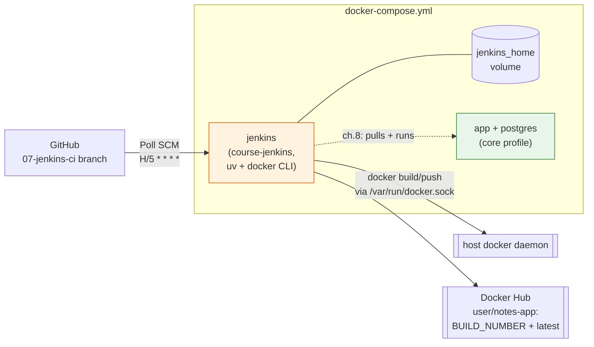

# 07 — Jenkins CI pipeline (in Docker)

> After this chapter, **a push to GitHub makes a machine rebuild the image**.
> No button, no SSH, no human: the pipeline checks out the code, runs your
> exact `make lint` / `make test` / build, and pushes the image to Docker Hub.

## Concept

CI = *the same commands a developer runs, run by a machine, on every commit*.
The whole pipeline is five `sh` stages, and the honesty is the point:

| Stage | Command | Where you already ran it |
|-------|---------|--------------------------|
| Lint | `uv run ruff check . && ruff format --check .` | `make lint` (ch.1) |
| Scan | `bash scripts/scan-secrets.sh` | `make scan` + pre-commit (ch.5) |
| Test | `uv run pytest -q` | `make test` (ch.2) |
| Build | `docker build -t notes-app .` | `make build` (ch.4) |
| Push | `docker login` + `docker push` (new) | — |

If CI is red, the mistake is one you could have made yourself; the pipeline
just refuses to ship it.

Two ideas carry this chapter:

- **The pipeline lives in a container, on the host daemon.** The `docker build`
  stage runs *inside* the Jenkins container but drives the *host's* Docker
  daemon through a mounted socket (`/var/run/docker.sock`). That's the gotcha:
  no Docker-in-Docker, no second daemon — the image that the pipeline builds
  is the one on your `docker images`. One bridge, one line to explain.
- **The trigger is owned by the repo, not the UI.** The `properties` step at
  the top of the Jenkinsfile writes `Poll SCM H/5 * * * *` into the job on the
  first build. After that, Jenkins asks GitHub *"did the branch move?"* every
  ~5 minutes; a pushed commit starts a build on its own. Local edits don't
  fire it — the poller compares the **remote tip**, not your disk.

And one quiet payoff: everything about *how* the pipeline is triggered and
*what* it does is now text in the repo — the Jenkinsfile is the single source
of truth you can read, diff, and review like any other code.

## What changed in this branch

| File | Change |
|------|--------|
| `Jenkinsfile` | New. The pipeline: `properties` (installs the Poll SCM trigger) + 5 stages. Scripted on the **controller** — `node` means "run in the Jenkins container itself"; no agents, no DinD. |
| `jenkins/Dockerfile` | New. `FROM jenkins/jenkins:2.580.2-lts` + two tools the stock image lacks: `uv` (Lint/Test) and the `docker` CLI (Build/Push). The base is the real Docker Hub image; plugins are *not* baked in — that's the one-time first-run step. |
| `docker-compose.yml` | New `jenkins` service, behind its own `jenkins` profile: build `course-jenkins`, named `jenkins_home` volume, host socket mounted, `user: "0"`, port 13000. |
| `Makefile` | New `make pipeline`: boots Jenkins and prints the one-time setup. |
| `README.md` | Branch-map row + ch.7 architecture snapshot. |

New concepts named in the code: **Poll SCM** (tip comparison against the
remote, `H/5 * * * *`), **`properties` step** (job config written *by* the
pipeline), **`withCredentials` / `--password-stdin`** (secret injected for one
block, masked in logs, never on the command line), and **build-number tags**
(`notes-app:6` = the commit of build #6, forever).

## Try it yourself

From a clean checkout of `07-jenkins-ci`:

```bash
make pipeline        # builds course-jenkins, boots Jenkins on :13000
```

Wait for "Jenkins is fully up and running", then open
`http://localhost:13000`. The **one-time setup** (takes ~5 minutes; the named
volume keeps it, so you never repeat it):

1. **Run the setup wizard** — at the "install suggested plugins" step, accept
   the defaults. That installs everything the pipeline uses: `git`,
   `workflow-aggregator` (the whole pipeline family), `credentials-binding`.
2. **Add the registry credential** — Manage Jenkins → Credentials → System →
   Global credentials → Add credentials: kind *Username with password*,
   **ID `docker-hub`** (fill this field!), your free Docker Hub account.
3. **Create the job** — New Item → `notes-pipeline`, type *Pipeline*.
   Definition: *Pipeline script from SCM*, Git, URL
   `https://github.com/<you>/devops-course.git`, branch `origin/07-jenkins-ci`.
4. **Build now** — five stages, then green.

After build #1, the trigger is live: make a trivial commit, `git push`, and
within ~5 minutes build **#2 appears started by "an SCM change"** — you
pressed nothing. Verify the artifacts:

```bash
docker images notes-app                # host image, rebuilt by the pipeline
# Docker Hub dashboard: amanupadhyay/notes-app, tags 2 + latest
```

## Common pitfalls

1. **`docker build` "works" but the image isn't in `docker images`.**
   Check the socket mount: `- /var/run/docker.sock:/var/run/docker.sock` in
   the compose file. Without it, the container's CLI has no daemon to talk
   to. (No Docker-in-Docker, no second daemon — that's the design.)

2. **Pipeline dies on `properties` with `Invalid input: "H/5"`.** `H/5` is
   the *UI preset* shorthand; the pipeline API hands the string to the real
   cron parser, which wants all five fields: `pollSCM('H/5 * * * *')`.
   (The `H` hashes the offset per job, so a class full of Jenkins boxes
   doesn't all poll GitHub at second 0 of the same minute.)

3. **The poll "doesn't fire" after a commit.** It polls the **remote tip**.
   `git commit` without `git push` changes nothing from Jenkins's point of
   view. And `H/5 * * * *` means "offset within each 5-minute window" — a
   push can wait up to ~5 minutes, by design.

4. **`Could not find credentials entry with ID 'docker-hub'.** The ID is a
   **string contract** between the UI and the Jenkinsfile. Leave the ID field
   blank and Jenkins stores the entry under a random UUID — the pipeline
   still looks for `docker-hub` and fails in one clean line, deep in a green
   pipeline. This is why the ID is pinned in the docs and the Makefile hints.

5. **`docker login` asks for a password inside a pipeline.** Don't — that's
   what `withCredentials` + `--password-stdin` replaces. If you ever see
   `auth failed` from a student, the credential is private-scope or
   a wrong ID, not the password format (a *refresh token* from Docker Hub
   Settings → Security works and is the better choice).

6. **First build hangs cloning GitHub mid-transfer** (`RPC failed; curl 56
   GnuTLS recv error`). Transient network blip, not a config problem —
   re-click Build now. (If it recurs on a specific link, that link is the
   lesson.)

## Stretch exercise

Replace the poller with a **webhook**: GitHub repo → Settings → Webhooks →
add the `jenkins` plugin's `GitHub hook` URL (or, off the shelf:
`curl -fsSL https://<jenkins>/github-hook`), and delete the `pollSCM` line.
Same pipeline, one round trip instead of up to five minutes. Then, in one
sentence each, say: (a) why a *secret token* makes this the production
shape, and (b) why the poll still has a job in the world (the poll is the
"GitHub goes down / webhook lost" backstop — run both, cost of five lines).

## Self-check quiz

1. Why does the pipeline run on the **controller** (plain `node`) rather than
   on an agent, and what two tools did we have to add to the controller image
   because of that?
2. `H/5 * * * *` — what does the `H` do, and why is that good for a class
   where every student's Jenkins polls the same GitHub?
3. A student commits, pushes, and waits 10 minutes: no new build. Name the
   three most likely causes, each fixable in under a minute.
4. Why does the Push stage use `--password-stdin` instead of a flag, and why
   does `docker login` survive container rebuilds?
5. In ch.8, the VPS deploy will `docker pull` the image this stage pushed.
   What property of the `notes-app:<BUILD_NUMBER>` tag makes "which commit is
   running in production?" a one-answer question?

<details>
<summary>Answers</summary>

1. One machine, no agent infrastructure to learn — `node` = "the Jenkins
   container itself". Two tools the stock image lacks: **`uv`** (Lint/Test
   need the same interpreter + tooling as the app image, ch.4) and the
   **`docker` CLI** (Build/Push drive the host daemon through the socket).
2. `H` randomizes the *offset within the unit* per job — job A might poll at
   0–4, job B at 3–7 of each 5-minute window. A class of students polling the
   same GitHub at the same second becomes a thundering herd; hashed offsets
   spread it. The 5-minute *granularity* is unchanged.
3. (a) commit but forgot `git push` — the poll watches the remote tip;
   (b) the trigger never installed — run a build once (the `properties` step
   writes it) or set Poll SCM in the job's UI; (c) network blips swallowed
   the poll — a later window catches up, or Build now proves the pipeline
   itself is fine.
4. A password on the command line shows up in `ps` and in logs; stdin keeps
   it off both. The docker CLI reads its auth from `~/.docker/config.json` —
   and this container's `HOME` is `/var/jenkins_home`, i.e. the named volume —
   so the login persists across rebuilds.
5. Build number = commit: stage 1 checks out one commit and runs; the image
   is tagged with that build's number, so `notes-app:6` *is* commit #6's
   tree. `latest` moves; the number doesn't — pin deploys to the number.

</details>

## Classroom demo checklist

**Show live** (fast, satisfying, low-risk):
- The poll firing: push a trivial commit, watch the dashboard — build #N
  appears *started by an SCM change*. ~30-second hold, then refresh.
- One green console top-to-bottom: Lint → Scan → Test → Build → Push,
  ~1.5 minutes on a warm volume.
- `docker images notes-app` on the host — the pipeline's artifact is *right
  here*.

**Pre-record / screenshot** (slow or noisy live):
- The **first-boot wizard + suggested plugins** — the volume makes it
  one-time, but live it's ~5 minutes of plugin churn.
- The `H/5` cron-parser failure vs the fixed `H/5 * * * *` — two screens
  tell the "UI preset ≠ pipeline string" story without making the class
  wait for a red build.
- Docker Hub dashboard, tags `2`…`N` + `latest` — "every build is a
  recoverable point in time."

## Architecture as of this chapter

The two-service ch.5 topology gains a **third service on its own profile** —
Jenkins — plus the two new lines of the story: a *poll* from GitHub and a
*push* to Docker Hub. The socket mount is the bridge between "runs in the
container" and "builds on the host".



Next chapter (ch.8) ships that pushed image: a VPS runs `docker compose` for
the app and gets the image from Docker Hub — and optionally hosts Jenkins
itself, so a push to GitHub deploys across the internet.
