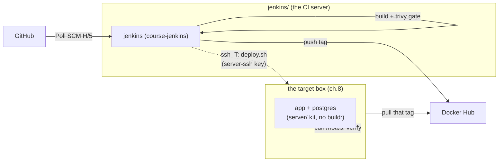

# 08 — Jenkins CD: deliver what CI proved

> After this chapter, **a green build is not just on Docker Hub — it is
> running on the target box**. The pipeline's new `Deploy` stage shaves one
> command off the box's day: pull the exact tag CI just pushed, swap the
> container, verify the app *answers*. Nothing to type after setup.

## Concept

CI (ch.7) answers *"is this code good?"*. CD answers *"is this code live?"*
—and the word that makes it a discipline is **artifact, not source**: the box
never builds. It runs the exact image that passed the Trivy gate and got a
tag. If it could build anything, a broken commit could still "work" on the
box and no one would know which one.

That one rule reshapes the whole design:

| Piece | What it is | Why it earns its place |
|-------|-----------|------------------------|
| `Jenkinsfile` → `Deploy` stage | `server/deploy.sh "$DEPLOY_USER/notes-app:<sha7>"` | the machine path: same script a human would run, different key + tag |
| `server/deploy.sh` | target-aware: `SERVER_HOST=127.*` → local; anything else → over `ssh -T` | ONE script, two machines — local and remote share the verify loop, so the lesson lands once |
| `server/bootstrap.sh` | converge a *bare* box once: Docker + compose plugin, clone, `.env`, `docker login`, known_hosts | the box's job after that is a single `compose up -d`; bootstrap owns the machine, deploy owns the app |
| `server/docker-compose.yml` | the box's manifest: **no `build:` section, ever** | the box pulls; a `build:` there would quietly undo the "artifact not source" rule |
| the `server-ssh` credential | the private half of a key the box trusts; lives only in Jenkins | ch.7's `docker-hub` credential pattern, applied to SSH |

**"Deliver" means the registry carries it.** Docker Hub is the transfer
medium: CI pushes the SHA tag (ch.7), the box pulls it. No `docker save | ssh |
docker load` — with the image already on a registry, the pull is simpler and
the tag *is* the commit (keep save|load only as the no-registry stretch below).

**Config, not procedure.** After `git pull`, a student changes `.env` vars and
runs one command. The knobs are `SERVER_HOST` / `SERVER_USER` / `SERVER_PORT`
(an IP is config, not a secret — ch.5's rule) and, on the human path,
`SERVER_SSH_KEY` (a *path* on your machine — a path is config; the key itself
is the secret that never ships). The ONE human step no script can do: your
**public** key into the box's `authorized_keys`.

## What changed in this branch

- **`Jenkinsfile`** — one new stage after Push: `Deploy`. Inside
  `withCredentials([sshUserPrivateKey(credentialsId: 'server-ssh',
  keyFileVariable: 'DEPLOY_KEY')])`, it exports the plugin's temp-file path as
  `DEPLOY_SSH_KEY_FILE` and runs
  `bash server/deploy.sh "$DEPLOY_USER/notes-app:${env.GIT_COMMIT.substring(0, 7)}"`.
  The key is a *path to a temp file*, never key material in the pipeline —
  nothing to echo, nothing to leak into the log.
- **`Jenkinsfile` post hooks** — `success` now prints two receipts: what's on
  Docker Hub **and** what the box is running. `failure` says the honest
  thing: a red build pushed nothing *and* deployed nothing; the box still
  runs its last green version.
- **`server/`** — the deploy-to-the-server kit: `bootstrap.sh` (the box runs,
  one-time converge), `deploy.sh` (the *pushing side* runs — Jenkins or a
  human via `make deploy`; only the compose command inside it ever executes
  on the box), `docker-compose.yml` (the box's manifest: app + postgres, no
  `build:`), `README.md` (this folder's setup + credential walkthrough).
- **`jenkins/docker-compose.yml`** — the controller's env block now carries
  `SERVER_HOST` / `SERVER_USER` / `SERVER_PORT` / `DEPLOY_USER` (from your
  root `.env`), so a new box is a one-var edit, versioned, no UI.
- **`jenkins/Dockerfile`** — adds the **docker compose v2 plugin binary**:
  the local dry-run (`SERVER_HOST=127.0.0.1`) runs `docker compose` *inside
  the controller* to point the app stack at the pushed tag.
- **`Makefile`** — `make deploy` (the human path: `server/deploy.sh` with your
  own key; `TAG=` for a specific pushed tag) + the ch.7/8 help lines.
- **`.env.example`** — the deploy knobs: `SERVER_*` (config) +
  `SERVER_SSH_KEY` (human-path key path; a path ships, the key does not).
  The key material lives in Jenkins' `server-ssh` credential, never in `.env`.
- **`docker-compose.yml` (root)** — the app service's `image:` reads
  `${APP_IMAGE:-notes-app}`, the seam the local dry-run points at a pushed tag.

## Try it yourself

```bash
make check && make up        # core stack green (ch.5)
make pipeline                # ch.7: the controller up; one-time UI setup on a fresh volume
```

1. **No VPS? Prove the whole chapter locally.** Leave `.env` at
   `SERVER_HOST=127.0.0.1`, push any commit, wait ~5 min (Poll SCM `H/5`),
   watch the new build's log end with:

   ```
   deploy: notes-app:latest -> 127.0.0.1:8000 (local dry-run target: same machine as CI)
   deploy: OK - notes-app:latest is live on 127.0.0.1:8000
   shipped: notes-app:<n> + <sha7> + latest on Docker Hub.
   deployed: that same tag is live on 127.0.0.1:8000.
   ```

2. **The VPS path.** Point `.env` at your box (`SERVER_HOST=<ip>`,
   `SERVER_USER=<box-login>`), run `./server/bootstrap.sh` *on the box*
   (installs Docker + compose, clones the repo, creates `.env`, prompts the
   one-time `docker login`, seeds known_hosts), append your **public** key to
   the box's `authorized_keys`. Now `make deploy` (your key, no arg → `.env`'s
   `APP_IMAGE`) or the pipeline's `Deploy` stage (`server-ssh` credential)
   does the same `compose up -d` over `ssh -T`.
3. **Verify idempotence.** Re-deploy the same tag (`make deploy TAG=<same-tag>`
   or Build-now): the compose step is a no-op, the container is untouched,
   and `deploy: OK` still prints — that's the contract, not a bug.
4. **Read the receipts.** After any green: `docker ps` on the box shows the
   running tag; it equals the build's SHA. That is ch.7's answer to *"what
   code is in prod right now?"* for free.

## Common pitfalls

All planted on purpose — each one was a real red build in this chapter.

1. **`--pull always` skipped, old code kept running.** A registry ref gets
   `up -d --no-build --pull always` so the *new tag* recreates the container.
   Without it, compose sees the image already local and changes nothing — the
   deploy "succeeds" and quietly keeps the old code. Symptom: green log,
   box still on yesterday's tag.
2. **`up -d` exited 0, the app didn't.** `compose up -d` exits 0 while the
   container crash-loops (it created the box; it doesn't watch it run — the
   same lesson ch.5's `make up` teaches). "Deployed" is defined as
   *the app answers*: deploy.sh's curl retry loop is the exit condition, not
   the container's.
3. **The box 401'd on pull.** The *box's* daemon has its own auth store
   (two daemons, two logins). One-time `docker login` on the box (bootstrap
   step 4) fixes it; a private repo you haven't logged into looks exactly
   like "rate limited" to a bare pull.
4. **Known-hosts: first contact.** The pipeline runs
   `StrictHostKeyChecking=yes` against a seeded `deploy_known_hosts` — first
   contact succeeds AND a changed host key still fails (the secure form);
   the human path uses `accept-new`. Unseeded + `yes` = the Deploy stage dies
   `Host key verification failed`.
5. **Postgres password drift (ch.5's pitfall, new home).** The `pgdata`
   volume bakes `POSTGRES_PASSWORD` at *first init*; the box's `.env` is
   copied **once** by bootstrap. Editing it later doesn't re-init — the app
   fails authentication and crash-loops. Fix: wipe the volume (the box's
   `docker compose down -v`), re-init, redeploy.
6. **The two box-side bugs that made build #1 red (real, found by the first VPS run).**
   (a) `BOX_DIR`'s default `$HOME/devops-course-server` expanded on the *CI*
   side and that literal path shipped to the box, whose `$HOME` is different —
   `cd: /var/jenkins_home/...: No such file or directory`. Fixed by shipping
   `\$HOME` (the box's shell expands it) unless `BOX_DIR` was set explicitly.
   (b) `docker compose -f server/docker-compose.yml` from the clone root does
   **not** auto-load the `.env` at the clone root — compose v2 auto-loads
   from the *project* directory (the compose file's dir, `server/`), not the
   CWD. POSTGRES_* interpolated to blank, db init died. Fixed with an
   explicit `--env-file .env`.

## Stretch exercise

Red → green without a new commit: break the box (kill its db, or point
`.env` at the wrong tag), let a build go red, fix the box, then Build-now —
the idempotent re-deploy of the same tag is the recovery path. (Or, no
registry at all: revive ch.7's `docker save | ssh docker load` transfer and
see what the pull replaced.)

## Self-check quiz

1. Why does the box's manifest have no `build:` section, and what would
   sneak back in if it did?
2. What exactly does `make deploy` verify, and why isn't "container is
   running" enough?
3. Name the three places the SSH private key may live — and the one place it
   may *never* live.
4. Your deploy log says `OK` but the box still runs the old image. Where in
   the script would you look first?
5. A student changes `SERVER_HOST` to a new VPS. What are the only steps
   left, and which of them can't be scripted?

<details>
<summary>Answers</summary>

1. The box runs an **artifact**, never source: it pulls what passed ch.7's
   gate. A `build:` there would let a broken commit "work" on the box and
   silently void the gate.
2. It verifies **the app answers** (curl retry loop until HTTP 200).
   `up -d` exiting 0 only means compose created/updated the box — it says
   nothing about whether the process inside is alive (pitfall #2).
3. The box's `authorized_keys` (public half, one human step), Jenkins'
   `server-ssh` credential (private half, encrypted on `jenkins_home`), and
   the human's local key file (path in `.env`'s `SERVER_SSH_KEY`). Never:
   the repo / `.env` / a command line — that's ch.5's secrets rule.
4. The `UPSPEC` selection — a registry ref must take `--pull always`
   (pitfall #1); a bare `up -d` against an already-local image changes
   nothing.
5. Edit `.env` (the vars), run bootstrap on the new box, add your public key
   to its `authorized_keys` — that last one is the only step that can't be
   scripted.

</details>

## Classroom demo checklist

- **Live (fast, low-risk):** the red→green recovery (build fails on a
  deliberately broken box → fix → Build-now → the two `deployed:` receipts).
  The idempotence no-op re-deploy — 20 seconds, very satisfying.
- **Pre-record / screenshot:** the one-time `server-ssh` credential creation
  (UI, ch.7-style), `docker ps` on the box showing the SHA tag, the bootstrap
  converge of a fresh VPS.

## Architecture as of this chapter


