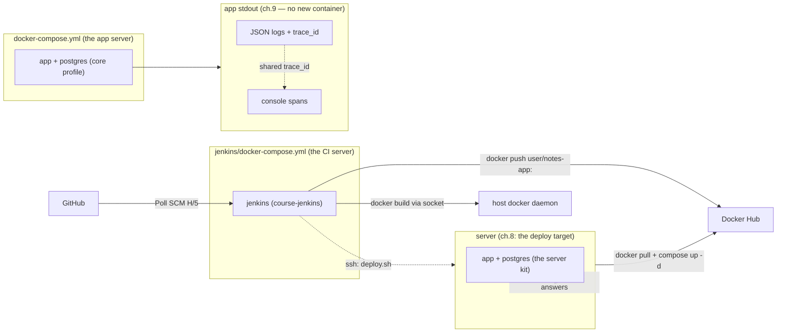

# 09 — Health & readiness + the OpenTelemetry tracing foundation

> After this chapter, **you can answer "is this box alive? can it take
> traffic?" with two different probes, and you can follow one request
> through the app as a *trace* — with that trace's id stamped onto every
> log line it produced.** The app now ships two probes (`/health`, `/ready`)
> and its first span exporter (console: traces print straight into the log
> stream). No new containers yet.

## Concept

A single "is it up?" endpoint is a lie, because it can only answer one of
two genuinely different questions:

| Probe | The question | Who asks it | What "yes" means |
|-------|--------------|-------------|------------------|
| **liveness** (`/health`) | is the process wedged? | an orchestrator deciding whether to **restart** the box | the HTTP server answers; it checks *nothing* else |
| **readiness** (`/ready`) | can it take traffic **right now**? | a load balancer deciding whether to **route** to it | the server is up *and* its dependencies can serve |

These diverge in the one case that matters: the app process is alive while
Postgres is still booting. A liveness probe says *keep it* (restarting a
box whose dependency will merely catch up is the classic crash-loop you
create by having one endpoint do both jobs). A readiness probe says *not
yet* (don't route real users to an instance that can't reach its DB). So
the course ships **both**, and that's the "health & readiness" half of the
title.

The "tracing" half is the same question one level up: not *"is it up"* but
*"when it is up, which request was the slow one, and what did it do?"*.
The answer is OpenTelemetry, and this branch deliberately lands only its
**foundation**:

- A **span** is one unit of work — here, one HTTP request. FastAPI's
  auto-instrumentation creates it, names it (`GET /notes`), and records its
  duration + method + URL + response status.
- A **trace** is the whole tree of spans for one request. Today it's one
  span each; ch.10 grows it (a database span under each request span).
- An **exporter** is where finished spans go. ch.9's answer is **console**:
  they print to stdout, in the *same stream* as ch.6's JSON logs. That
  "zero new infrastructure" is the whole point of the chapter — you watch
  your first trace waterfall with `make up` + `make logs` and change nothing
  about the machine.

And the move that ties the two halves together: **every log line written
during a request now carries that request's `trace_id`.** A log emitted by
`views.py` while a request span is active gets stamped with that span's
trace id. So "find every log line request X produced" is one grep — and in
ch.10 that same id is how SigNoz joins its log view to its trace view.

Two environment knobs own the whole thing (ch.5's "behavior from the
environment" rule): `OTEL_ENABLED` (the off switch — tests use it) and
`OTEL_EXPORTER` (`console` here, `otlp` in ch.10 — a one-line flip).

## What changed in this branch

- **`notes_app/health.py`** (new) — the two probes as their own router:
  `/health` returns `{"status": "ok"}` and deliberately checks nothing else;
  `/ready` returns `{"status": "ready"}` (the main track; the stretch
  exercise makes it actually ping the DB).
- **`notes_app/otel.py`** (new) — all of the tracing foundation in one
  module: builds a `TracerProvider`, picks the exporter from
  `OTEL_EXPORTER` (console now, OTLP-gRPC pre-wired for ch.10), instruments
  the FastAPI app, and registers a `trace_id` hook with the logger. Every
  `import` of OpenTelemetry lives *inside* `setup_otel`, so `OTEL_ENABLED
  = false` means it is genuinely not loaded.
- **`notes_app/main.py`** — mounts the health router (next to the app
  router) and calls `setup_otel(app)` last, once the app is fully built.
- **`notes_app/logging_config.py`** — `trace_id` joins `_FIELDS`, and a
  tiny provider hook (`set_trace_id_provider`) lets otel.py supply the
  active span's trace id without the logging module importing OpenTelemetry.
  When OTel is off, the hook is `None` and the field is simply absent —
  no fake `0000…0`.
- **`pyproject.toml` + `uv.lock`** — four packages: `opentelemetry-sdk`,
  `-instrumentation-fastapi`, `-exporter-otlp-proto-grpc` (the ch.10
  flip; console needs no package), on top of `opentelemetry-api`.
- **`Dockerfile`** — a `HEALTHCHECK` on `/health` (curl ships with the base
  image), so the artifact declares its own liveness.
- **`docker-compose.yml`** — the app service gains a `healthcheck:` pointing
  at the same endpoint (mirrors the Dockerfile), and the four `OTEL_*`
  env vars (with working defaults, so a bare `.env` runs
  instrumented-to-console).
- **`server/deploy.sh`** — its "did it deploy?" verify curls **`/ready`**
  instead of `/notes`: the readiness probe is the honest
  "this instance can take traffic" check, which is the contract CD should
  verify against.
- **`.env.example`** — the `OTEL_*` knobs, documented (all have defaults).
- **`tests/`** — `conftest.py` sets `OTEL_ENABLED=false` (no exporter
  threads, no console spam between tests); `test_app.py` adds the two
  probe tests.

The honest scope line: **nothing new starts on the machine.** The exporter
is stdout. SigNoz — the thing that receives traces — is ch.10.

## Try it yourself

```bash
make check && make up        # core stack green (ch.5), now instrumented
```

1. **The two probes.**
   ```bash
   curl -s localhost:8000/health   # {"status":"ok"}
   curl -s localhost:8000/ready     # {"status":"ready"}
   ```
   Both answer the instant the server is up. That is the exact contract the
   Dockerfile's `HEALTHCHECK` and compose's `healthcheck:` rely on.

2. **Watch your first trace.** In another terminal:
   ```bash
   make logs                    # ch.6's target, now carrying spans
   ```
   Then make a request (`curl -s localhost:8000/notes`, or open the app
   and create a note). You'll see ch.6's JSON log lines **and**, right in
   the same stream, the console exporter's span objects — one
   `"name": "POST /notes"` span, plus its `http send`/`http receive`
   children. No new container was started; the trace is a log line.

3. **The correlation that justifies the chapter.** Grep one trace id across
   the log:
   ```bash
   TID=$(curl -s localhost:8000/notes >/dev/null; docker compose --profile core logs --tail 200 app | grep -o '"trace_id": "[0-9a-f]\{32\}"' | head -1 | grep -o '[0-9a-f]\{32\}')
   docker compose --profile core logs app | grep "$TID"
   ```
   Every log line *and* every span for that one request share `"$TID"`.
   That is "find everything one request did" in one command.

4. **The off switch.**
   ```bash
   OTEL_ENABLED=false make run    # no spans; log lines carry no trace_id
   ```
   Confirm `grep trace_id` on the log finds nothing. `false` means the
   OpenTelemetry machinery is not even imported.

## Common pitfalls

- **"Why don't I see spans?"** — the console exporter prints spans to the
  *app's* stdout, so you see them via `make logs` / `docker logs`, not in
  the terminal running `make run` until they flush. `BatchSpanProcessor`
  flushes periodically and at shutdown — if you stopped the app instantly,
  a few spans may not have printed yet.
- **`curl` missing in the container.** The `HEALTHCHECK` uses `curl`, which
  ships with the course's base image (`uv:python3.12-bookworm`). It does
  **not** ship with `*-slim`/alpine variants — the #1 reason a
  copy-pasted `HEALTHCHECK` "fails" on a minimal image is a missing `curl`,
  not a failing endpoint.
- **`trace_id` is sometimes absent from a log line.** That's correct, not a
  bug: the field is only stamped when a request span is *active*. Startup
  logs, background work, and any log written outside a request have no
  active span, so the field is omitted (never a fake `0000…0`).
- **`OTEL_ENABLED=false` doesn't mean "no trace_id field" in the *code*.**
  The field is in `_FIELDS` regardless; it only appears when a provider is
  registered (i.e. OTel is on) *and* a span is active.
- **The `http://` OTLP endpoint foot-gun (ch.10, pre-wired now).** The gRPC
  OTLP exporter speaks over a plain-HTTP URL — `http://signoz:4317` — not
  `https://`. Copy-pasting an `https` endpoint is the classic "exporter
  starts, then errors forever" mode. It's already the value in
  `docker-compose.yml`; it just isn't used until ch.10.

## Stretch exercise

Make `/ready` *actually mean ready.* Right now it returns 200 because the
server is up — the honest liveness-style answer. The real definition is
"my dependencies can serve." Wire a dependency check into the readiness
probe so it returns **503** when they can't:

```python
# in notes_app/health.py, the docstring already says where this lands.
# Query your data layer with the SAME engine models.py uses - one line:
from .models import engine

with engine.connect() as conn:
    conn.exec_driver_sql("SELECT 1")
```

Return `503` (and a `{"status": "not ready"}` body) when the query raises.
The payoff: `docker compose`'s `service_healthy` (and the `depends_on:
service_healthy` pattern ch.5 already uses for the DB) now reflects the
*true* readiness of the app, not just "process started."

## Self-check quiz

1. An app container is up but Postgres is still booting. What does
   `/health` return, and what does `/ready` *should* return? Why is it
   wrong to answer both with one endpoint?
2. In this branch, where do spans physically go, and how do you read them?
   What must change to send them somewhere you can *look at*?
3. A log line written during a request carries `trace_id`. A log line
   written at startup does not. Why is that the correct behavior rather than
   a bug?
4. Why do all OpenTelemetry imports live inside `setup_otel` instead of at
   the top of the module?

<details>
<summary>Answers</summary>

1. `/health` → 200 (the process *is* alive — liveness only asks that).
   `/ready` should → 503 (its dependency can't serve, so it must not take
   traffic). One endpoint can't do both because the recovery actions
   differ: liveness-"no" justifies a **restart**; readiness-"no" justifies
   **holding traffic back** while the box catches up. Merging them means
   restarting a box that merely needs to wait — the crash-loop.
2. To **stdout**, the same stream as the logs — you read them with
   `make logs` / `docker logs`. To look at them you need a destination:
   ch.10 flips `OTEL_EXPORTER` to `otlp` (one env var) so the same spans
   ship to SigNoz. The code that *makes* the spans never changes; only the
   exporter does.
3. Because there's no request, so there's no active span, so there's no
   trace to point at. Printing a zero-padded `0000…0` would be *worse* —
   it would look like a real (but unknown) trace. Absent is the honest
   value; the code returns `None` and the formatter omits the key.
4. So the off switch is total. `OTEL_ENABLED=false` skips the function body,
   so the `TracerProvider`, the exporter, and the instrumentation are never
   constructed and never even imported — no background flush threads, no
   hidden cost. That's the guarantee the test suite and any
   "run without telemetry" deployment rely on.

</details>

## Classroom demo checklist

- **Show live** (fast, satisfying, low-risk):
  - `curl /health` and `curl /ready` — two probes, two answers, instant.
  - `make logs` running, then one request → **watch a span object and a
    `note_created` log line appear together, sharing a `trace_id`**. This is
    the chapter's "aha" and it's deterministic.
  - `OTEL_ENABLED=false make run` → "same app, no spans, no trace_id in the
    logs" in one line.
- **Pre-record / screenshot** (slower or noisier):
  - Scrolling the full console span waterfall (many spans at once is noisy
    on a projector; a trimmed screenshot tells the same story).
  - The grep that pulls *all* lines for one `trace_id` across a longer log.

## Architecture as of this chapter

**Nothing in the topology changes** — that's the point. ch.9 adds no
service; the exporter is the app's own stdout. The same ch.8 diagram stands;
what changes is *what the app emits*: its log stream now also carries the
span stream, correlated by `trace_id`.



The `signoz` box is deliberately **not** here yet — it lands next, in
ch.10, when `OTEL_EXPORTER` flips to `otlp`.
