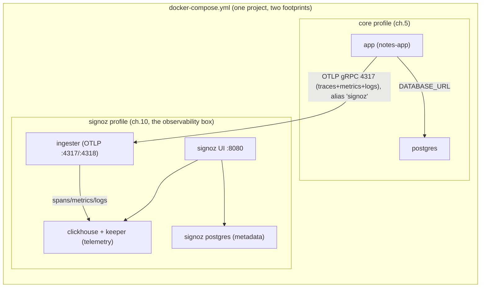

# 10 — SigNoz: traces, metrics and logs in one tool

> After this chapter, **your app ships all three pillars — traces, metrics
> and logs — over OTLP to a self-hosted SigNoz, and you can open a UI that
> joins them by the same `trace_id` ch.9 stamped on every log line.** One
> tool, one place, one incident drill in which you actually *find* the
> failure instead of being told where it is.

## Concept

ch.9 left a trace printing to stdout, next to the logs. That is a
waterfall you can `grep`, but it is not a place you can *look*: no spans
history, no metrics, no "show me every request that errored in the last
hour." SigNoz is the backend that answers ch.9's open question — an
OpenTelemetry-native observability platform (traces + metrics + logs in one
database, ClickHouse). This course's observability arc lands **directly** on
it (PLAN, §ch.10 self-host plan): no Prometheus + Grafana + Jaeger detour.

Two framing points:

- **Why self-host, not the 30-day SigNoz Cloud trial?** The trial works,
  but it violates the course's one rule (free & self-contained, no cloud
  account), time-bombs mid-course, and takes your data off the machine.
  Self-hosting also *is* the lesson: a stack, on a box, under your control
  (PLAN's §ch.10 comparison table). The cloud trial is the escape hatch
  for "my laptop is under 4GB," noted below — never the main track.
- **One tool replaces three, because OTLP is the common language.** The
  app speaks OpenTelemetry (ch.9's `otel.py`); SigNoz's collector speaks
  OTLP on `4317`. What arrives — spans, metrics, log lines — is stored in
  one database and cross-linked by `trace_id`, so "the logs of the request
  that had the slow span" is one click, not one grep across three UIs.

The layout is the course's "one folder = one machine" rule, applied a
third time: `signoz/` is the observability box (the vendored Foundry
bundle — `signoz/compose.yaml` is Option B's whole project), and the root
compose's `signoz` **profile** (Option A, the lab default) folds the same
seven services into the app's project so the app reaches the collector over
its own network. Details in [signoz/README.md](../signoz/README.md).

## What changed in this branch

- **`signoz/`** (new) — the **official Foundry bundle**, vendored:
  `compose.yaml` (Option B: its own compose project), the collector /
  ClickHouse / Keeper config files, and `casting.yaml` + its lock
  (provenance — regenerate with `foundryctl forge` anytime). `:latest`
  image tags exactly as Foundry emits them.
- **`docker-compose.yml` (root)** — the seven SigNoz services under
  `profiles: ["signoz"]` (ingester, UI, its postgres, keeper, clickhouse,
  + two one-shot jobs), a `signoz-network` the **app also joins** so
  `OTEL_OTLP_ENDPOINT=http://signoz:4317` (ch.9's pre-wired default)
  resolves with zero app-side change, and four named volumes for the
  telemetry data.
- **`notes_app/otel.py`** — the chapter's app-side diff, built on ch.9's
  foundation:
  - **metrics**: `http_requests_total` (counter) +
    `http_request_duration_seconds` (histogram), an HTTP middleware,
    exported via `PeriodicExportingMetricReader` (2s in otlp mode).
  - **database child spans**: the SQLAlchemy instrumentor — each request's
    trace now shows a `SELECT/INSERT` span *under* the HTTP span, which
    is what the incident drill's "find the failing span" depends on.
  - **log export**: in otlp mode a `LoggingHandler` rides the standard
    logger into SigNoz's log pipeline — no sidecar container; the ch.9
    `trace_id` is what joins those logs to the trace view.
  - console mode is untouched: `OTEL_EXPORTER=console` still works
    (ch.9's state), so the branch is safe with SigNoz never started.
- **`pyproject.toml` + `uv.lock`** — `opentelemetry-instrumentation-sqlalchemy`
  added. (The log pipeline needs **no** extra package:
  `opentelemetry.sdk._logs` + the OTLP log exporter ship inside
  `opentelemetry-sdk` / `-exporter-otlp-proto-grpc`, already locked in ch.9.)
- **`Makefile`** — `make up-signoz` (core + signoz, verifies the **UI
  answers**, not "all containers up"), `make down-signoz` (stop; keep
  data), `make reset-signoz` (wipe SigNoz's four volumes *only* — never
  `down -v`, which would also drop your notes' `pgdata`).
- **`scripts/check.sh`** — port gate now `8080` (SigNoz UI), `4317/4318`
  (OTLP) instead of the archived variant's `8080/9095`.
- **`.env.example`** — the OTEL block re-documented: the flip is
  `OTEL_EXPORTER=otlp` + `OTEL_OTLP_ENDPOINT` (defaults unchanged, so a
  bare `.env` still means "ch.9, console").

## Try it yourself

```bash
make check
make up-signoz          # core + signoz; first boot = pulls + migration, ~90s
```

1. **First visit: create the admin.** Open `http://127.0.0.1:8080` — the
   UI asks you to **create the admin account** (no baked credentials;
   that is deliberate). Note the credentials for the next steps.

2. **Prove the pillar you already had.** The ch.9 state is still live:
   `OTEL_EXPORTER=console`. You should see no `notes-app` service yet in
   SigNoz's *Services* page — that absence is the setup, not a bug.

3. **The flip (one line).** In `.env`:
   ```
   OTEL_EXPORTER=otlp
   ```
   then:
   ```bash
   docker compose --profile core up -d --build --force-recreate app
   curl -s localhost:8000/notes          # generate traffic
   ```
   `--build` because `--force-recreate` re-runs the *image*, it does not
   rebuild it (pitfall #2 below).

4. **Watch the three pillars land** (SigNoz UI, logged in):
   - *Services*: `notes-app` appears within a minute or two (the
     collector gates its write path on the one-time schema migration —
     pitfall #1).
   - *Traces*: open one request — an HTTP server span **with a child
     database span** under it; the span's `trace_id` equals the
     `trace_id` field in the app's JSON logs (`make logs`), and matches
     the id on the log lines under *Logs* → filter by service `notes-app`.
   - *Metrics*: `http_requests_total` and
     `http_request_duration_seconds`, plus SigNoz's own RED metrics
     (rate/errors/duration) derived from the spans.

5. **One SLO alert** (the course's only alert, on purpose): in SigNoz
   *Alerts → Create*, either **error rate** — spans with status `ERROR`
   above 10% of all spans, 5-minute window — **or latency** — p95 of
   `http_request_duration_seconds` above 500ms sustained. This is a
   SigNoz alert (its metadata DB), not a Prometheus rule — the whole
   "three tools → one" payoff: the SLO lives where the traces live.

6. **The incident drill.**
   ```bash
   docker compose --profile core stop db     # pull the rug from under the app
   curl -s -o /dev/null -w '%{http_code}\n' localhost:8000/notes   # 500
   ```
   - The SLO alert fires.
   - Open the trace view: the request's tree shows the **database child
     span red** (SQLAlchemy instrumentor records the connection error),
     while the HTTP span stays up — *which part* failed is visible, not
     guessed.
   - Write it up: one paragraph joining `alert → trace_id → the failing
     span → the cause` (the "story" a real on-call writes).
   ```bash
   docker compose --profile core start db     # recover; watch the alert clear
   ```

## Common pitfalls

The ones we hit, written down on purpose:

1. **Data lags a fresh boot — the stack is "up" before it is "writing".**
   The collector's command runs `migrate sync check` first; until the
   one-shot **migrator** job finishes the schema migrations, trace
   batches queue, not write. So "all containers up + UI 200" can still
   mean *zero spans stored* for the first minute or two. Verify in the
   **UI's data** (or a clickhouse count), not container state — which is
   why `make up-signoz` gates on the UI answering and the doc's steps
   say "within a minute or two."
2. **`--force-recreate` is not `--build`.** After the `.env` flip, an app
   image *older* than the ch.10 `otel.py` crash-loops at boot
   (`ModuleNotFoundError` on the OTLP exporter — exactly what we hit on a
   stale image: the ch.9 branch's pre-fix code had the same class of bug,
   fixed in `8c83505`). Recreate-from-current-source, i.e.
   `up -d --build --force-recreate app` (or `make up-signoz` first).
3. **The ingester's log looks broken. It isn't.** The collector's opamp
   management link to the UI logs periodic `Server returned an error
   response` lines — a housekeeping channel, not the data path. The data
   path is OTLP 4317 → ClickHouse; judge it by spans, not by that log.
4. **Two containers that say "exited" are doing their job.** The
   `user-scripts` and `migrator` services are one-shot jobs
   (`restart: on-failure`); after a green boot they sit in
   `exited (0)`. "7/7 running" is the *wrong* success criterion — the
   right one is "the four long-running services are healthy and the UI
   answers."
5. **First boot needs the internet, once.** The `user-scripts` job
   downloads the ClickHouse histogram-quantile UDF from GitHub's
   releases into the `user_scripts` volume. After that the volume holds
   it; an offline machine still boots from an existing volume.
6. **`OTEL_OTLP_ENDPOINT` scheme foot-gun.** OTLP/gRPC speaks over
   `http://` (plain gRPC channel, `insecure=True` in code), not
   `https://`. Copy-pasting an https endpoint = "exporter starts, then
   errors forever."
7. **Ports.** SigNoz's UI takes host `8080`; Jenkins' UI is host `13000`
   (its *container* also listens on 8080, but it is not published — no
   host clash). `make check` now guards 8080/4317/4318, so a second
   `up-signoz` while SigNoz already runs fails loudly with the owning
   process named.
8. **Never `down -v` the root project** to "reset" SigNoz — it drops
   `pgdata` with it (the ch.5 gotcha, in reverse). `make reset-signoz`
   removes exactly the four `devops_course_signoz-*` volumes.

## Stretch exercise

Make the SLO alert *scriptable*: SigNoz's alerts are metadata in its
postgres, but it also exposes an API — recreate your alert via
`curl`/the API (service account → API key, docs step in
[signoz/README.md](../signoz/README.md)), so an alert lives in the repo
next to the code it watches. Alternatively: run the same drill with
*injected latency* (`tc qdisc add dev ... netem delay 500ms` on the db
container's interface, or a `time.sleep` in a new view) and confirm the
p95 SLO — not the error-rate SLO — is the one that fires.

## Self-check quiz

1. After `make up-signoz`, all containers are up and the UI returns 200,
   yet the *Services* page shows no `notes-app` for a while. What are
   three distinct reasons that could be (two of which are not bugs)?
2. What is the one-line change that turns ch.9's console exporter into
   ch.10's SigNoz pipeline — and what *else* must happen for it to
   actually take effect on a running stack?
3. Why are there two containers that end in `exited (0)` after a healthy
   boot, and why is "7/7 running" the wrong thing to check?
4. In the incident drill, the HTTP span is still "up" after you stop the
   DB, yet the failure is obvious in the trace. Which span shows it and
   *why* does it exist at all?
5. Why does `make reset-signoz` remove four volumes by name instead of
   running `docker compose down -v`?

<details>
<summary>Answers</summary>

1. (a) the app still exports to **console** (`.env` not flipped / not
   recreated); (b) the app's image predates the OTLP code (pitfall #2);
   (c) the collector is mid-migration-gating — the data is queued, not
   yet written (pitfall #1: not a bug, a wait); (d) endpoint scheme
   wrong / endpoint points at a host where no collector listens.
2. `OTEL_EXPORTER=otlp` in `.env` — plus **recreating the app container**
   (env is read at boot; `--force-recreate` re-runs the *old* image, so
   pair it with `--build`).
3. `user-scripts` and `migrator` are one-shot jobs (`restart: on-failure`):
   they do their work, exit 0, and stay exited. The health criteria are
   the four long-running services + the UI answering.
4. The **database child span**, red / status `ERROR` — it exists because
   ch.10 added the SQLAlchemy instrumentor, so each request's trace
   carries a `SELECT/INSERT/...` span under the HTTP span. That's the
   "which part failed" detail a bare HTTP status can't give.
5. `down -v` on the root project deletes *its* named volumes — including
   `pgdata`, your notes. The SigNoz reset must be surgical: its four
   `devops_course_signoz-*` volumes only.

</details>

## Classroom demo checklist

- **Show live** (fast, deterministic, low-risk):
  - `make up-signoz` → the honest "waiting ~90s, first boot migrates the
    schema" beat (it teaches pitfall #1 by living it).
  - The flip: one `.env` line + one command; a request; `notes-app`
    appearing in *Services*.
  - **The incident drill, start to finish**: stop the db → alert fires →
    the red DB span in the waterfall → `start db` → alert clears. This is
    the chapter's payoff and it is fully local and repeatable.
- **Pre-record / screenshot**:
  - Creating the admin account (the *Services* → *Traces* → *Metrics* →
    *Logs* tour is clicky, not time-critical).
  - The log-trace join: the same `trace_id` in `make logs` and in the
    trace waterfall side by side (the ch.9 ↔ ch.10 link, made visible).

## Architecture as of this chapter

SigNoz is **one box, five long-running containers + two one-shot jobs**,
folding into the app server project via the `signoz` profile; the app's
telemetry crosses the shared network once (4317) and never comes back.



**As of ch.10:** the observability box finally has a place to receive what
ch.9 emitted. Three pillars, one database, one UI; the SLO alert and the
incident drill live here, where the course's observability story was always
going to end. (Option B — `signoz/` as its own project on a VPS — is the
same bundle one `docker compose -f` away; [signoz/README.md](../signoz/README.md).)
