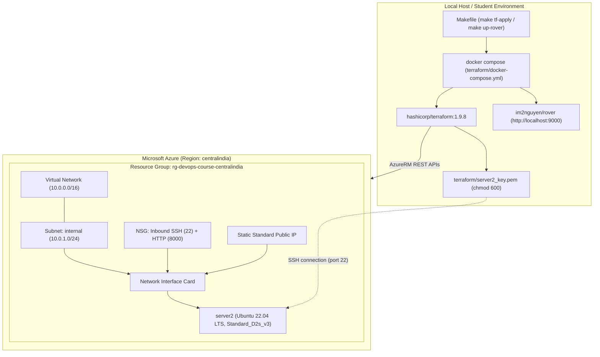

# 11 — Infrastructure as Code: Terraform, Azure & Rover

> After this chapter, **you can automatically provision and destroy real cloud infrastructure in Microsoft Azure (an Ubuntu VM `server2`, virtual network, public IP, and SSH keys) using Terraform inside Docker, and visually inspect your architecture using the self-hosted Rover dashboard on `http://127.0.0.1:9000`.**

---

## Concept

In chapter 8, we deployed our app to a remote server over SSH. But how was that server created in the first place?
Manual "clickOps" (clicking buttons in the Azure / AWS console) is:
- **Error-prone**: Missing a firewall rule or choosing the wrong subnet causes silent outages.
- **Undocumented**: No git history tells you who changed an IP or opened a security group.
- **Slow & Unrepeatable**: Creating a second test environment means clicking everything again.

**Infrastructure as Code (IaC)** with **Terraform** treats cloud resources like software code:
1. **Declarative**: You declare the desired end state (`azurerm_linux_virtual_machine "server2"`), and Terraform calculates the delta required to reach it.
2. **Deterministic execution plan**: `terraform plan` shows exact additions, modifications, and deletions before touching real cloud resources.
3. **Reproducible teardown**: `terraform destroy` cleanly removes everything in reverse dependency order, preventing stray cloud charges.

### Why in Docker?
Just like `jenkins/` (ch.7) and `signoz/` (ch.10), Terraform and Rover live in their own standalone folder:
- **Zero host dependencies**: Students do not need Terraform or the Azure CLI installed locally.
- **Pinned toolchain**: Every student and CI agent runs the identical Terraform core (`1.9.8`) and AzureRM provider (`~> 3.116.0`).
- **Visual inspection**: The **Rover** container gives an interactive web visualizer on `http://127.0.0.1:9000` to inspect resource dependencies before applying.

---

## What changed in this branch

- **`terraform/` (new folder)**:
  - `docker-compose.yml`: Standalone runner for `hashicorp/terraform:1.9.8` and `im2nguyen/rover:latest`.
  - `versions.tf`: Pinned provider blocks for `azurerm`, `tls`, and `local`.
  - `variables.tf`: Configurable parameters: VM name (`server2`), region (`centralindia`), size (`Standard_D2s_v3`), and admin username.
  - `main.tf`: Declarations for Resource Group, Virtual Network, Subnet, Static Public IP, NSG (ports 22 and 8000), NIC, auto-generated 4096-bit RSA SSH key, and the Ubuntu VM.
  - `outputs.tf`: Exports the public IP and ready-to-run SSH command.
  - `terraform.tfvars.example`: Example overrides file.
  - `README.md`: Quick reference guide.
- **`Makefile`**:
  - `make tf-init`: Download providers inside the Docker container.
  - `make tf-plan`: Compute execution plan and generate `plan.json`.
  - `make tf-apply`: Provision resources in Azure (auto-approved).
  - `make tf-output`: Display the public IP and SSH login command.
  - `make tf-destroy`: Cleanly destroy all Azure resources.
  - `make up-rover` / `make tf-ui`: Launch the interactive visualizer on `http://127.0.0.1:9000`.
  - `make down-rover`: Stop the visualizer container.
- **`.gitignore`**:
  - Ignores `.terraform/`, `*.tfstate*`, `*.tfplan`, and `*.pem` keys.

---

## Try it yourself

Ensure your Azure credentials are set in the root `.env` (`ARM_CLIENT_ID`, `ARM_CLIENT_SECRET`, `ARM_SUBSCRIPTION_ID`, `ARM_TENANT_ID`).

### Step 1: Initialize Terraform
```bash
make tf-init
```
*Expected output:* Terraform downloads the `azurerm`, `tls`, and `local` provider plugins into the docker-cached volume and creates `.terraform.lock.hcl`.

### Step 2: Preview the changes
```bash
make tf-plan
```
*Expected output:* `Plan: 10 to add, 0 to change, 0 to destroy.` It also outputs `plan.json` for Rover.

### Step 3: View the interactive Architecture Graph in Rover
```bash
make up-rover
```
*Action:* Open [http://127.0.0.1:9000](http://127.0.0.1:9000) in your browser. You will see an interactive graph mapping the Resource Group, VNet, Subnet, NSG, Public IP, NIC, and `server2` VM.
When finished viewing:
```bash
make down-rover
```

### Step 4: Provision the VM in Azure
```bash
make tf-apply
```
*Expected output:* Azure creates the networking and VM in ~60-90 seconds:
```text
Apply complete! Resources: 10 added, 0 changed, 0 destroyed.

Outputs:
public_ip = "52.140.xx.xx"
resource_group_name = "rg-devops-course-centralindia"
ssh_login_command = "ssh -i terraform/server2_key.pem azureuser@52.140.xx.xx"
ssh_private_key_file = "./server2_key.pem"
vm_name = "server2"
```

### Step 5: SSH into `server2`
Run the output command:
```bash
ssh -i terraform/server2_key.pem azureuser@<YOUR_PUBLIC_IP>
```
Inside the server, verify the specs:
```bash
uname -a
lscpu | grep "CPU(s):"
free -h
exit
```
*(Confirms 2 vCPUs and 8GB RAM as provisioned by `Standard_D2s_v3`)*.

### Step 6: Clean up (Destroy)
Always destroy test cloud resources when finished to avoid billing:
```bash
make tf-destroy
```
*Expected output:* `Destroy complete! Resources: 10 destroyed.`

---

## Common pitfalls

| # | What it looks like | Why it happens | The fix |
|---|---|---|---|
| 1 | `Error: building AzureRM Client: ... ARM_CLIENT_ID is not set` | Missing variables in `.env` or invoked without loading `.env` | Put credentials in root `.env`. The `Makefile` passes `--env-file .env` automatically. |
| 2 | `Permissions 0644 for 'server2_key.pem' are too open` | SSH rejects private keys readable by other users | `local_file` resource enforces `file_permission = "0600"`. If copied manually, run `chmod 600 terraform/server2_key.pem`. |
| 3 | `SkuNotAvailable` / `QuotaExceeded` | The requested VM size is restricted in the target region for your subscription | Use `Standard_D2s_v3` or `Standard_B2s` in `centralindia` where quotas are widely available. |
| 4 | Leaving VMs running overnight | Forgetting `make tf-destroy` | Always run `make tf-destroy` at the end of every lab session. |

---

## Stretch exercise

Add a cloud-init script (`custom_data`) to `azurerm_linux_virtual_machine` in `main.tf` that automatically installs Docker on `server2` when it first boots, so it is immediately ready to accept container deployments from ch.8's `make deploy`.

---

## Self-check quiz

1. Why do we store Azure credentials in `.env` rather than hardcoding them in `main.tf`?
2. What is the difference between `terraform plan` and `terraform apply`?
3. How does `tls_private_key` paired with `local_file` simplify SSH access compared to manual key generation?
4. What happens to the state file (`terraform.tfstate`) if you delete it manually while resources still exist in Azure?

<details>
<summary>Answers</summary>

1. Hardcoded credentials will accidentally leak into git version control. Storing them in `.env` keeps secrets separate from code and allows different environments to use different credentials.
2. `terraform plan` is read-only: it compares the desired code against current cloud state and shows proposed actions without making changes. `terraform apply` executes the API calls to build or update the infrastructure.
3. Terraform handles the entire key lifecycle: it generates a cryptographically secure 4096-bit RSA key pair, pushes the public key directly into the Azure VM during provisioning, and writes the private key with strict `0600` permissions locally, so you can connect in one step without manual key-wrangling.
4. Terraform loses track of what it created. If you run `terraform apply` again, it will attempt to recreate resources (causing name collision errors), and `terraform destroy` will not know what to delete, leaving orphaned resources running in your cloud account.
</details>

---

## Architecture as of this chapter



