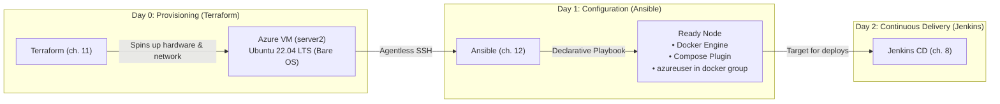
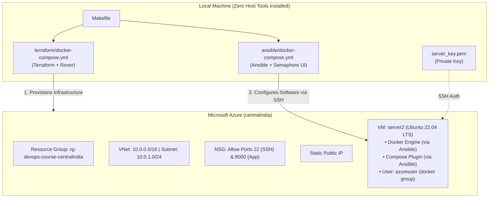

# 12 — Configuration as Code: Ansible, Docker Provisioning & Semaphore UI

> After this chapter, **you can automatically configure a freshly provisioned cloud VM (installing Docker, Docker Compose, user permissions, and dependencies) using Ansible playbooks running inside Docker, and manage executions via the Ansible Semaphore web UI on `http://127.0.0.1:3000`.**

---

## Concept

In Chapter 11, we learned **Infrastructure as Code (IaC)** with Terraform. With a single command (`make tf-apply`), Terraform created an Azure Resource Group, Virtual Network, Subnet, Public IP, and an Ubuntu VM (`server2`).

However, right after Terraform finishes, you are left with a **bare Linux operating system**:
- No Docker daemon
- No Docker Compose plugin
- No application users or groups
- No security baselines or monitoring agents

### Why not just use a Bash script?
In Chapter 8, we used `server/bootstrap.sh` to configure a VPS. While bash scripts work for simple tasks, at scale they suffer from severe limitations:
1. **Imperative, not declarative:** In bash, you tell the machine *how* to do things step-by-step (`if ! command -v docker...`). In Ansible, you tell it *what the desired end-state is* (`state: present`, `state: started`).
2. **Idempotency is manual in bash:** Writing a bash script that can run 10 times consecutively without breaking or reinstalling packages requires complex defensive scripting. Ansible modules are idempotent by default.
3. **No multi-host orchestration:** Running a bash script across 10 or 100 servers requires custom loops or wrappers. Ansible uses an inventory to orchestrate whole fleets simultaneously.



### Key Ansible Architecture Principles
1. **Agentless (Push Model):** Ansible does not require any background daemon or software installed on the target VM. It connects over standard SSH, copies Python modules to a temporary directory on the remote host, executes them, and cleans up.
2. **Containerized Execution:** Just like Jenkins, SigNoz, and Terraform, Ansible runs inside Docker. Students do not need Python virtual environments or `ansible-core` installed locally.
3. **Ansible Semaphore Web UI:** To provide a visual experience equivalent to Rover in Chapter 11, we include **Semaphore UI**—a modern, lightweight (~80MB RAM) open-source web interface for Ansible to inspect inventories and execute playbooks.

---

## What changed in this branch

- **`ansible/` (new folder)**:
  - `docker-compose.yml`: Standalone runner for the Ansible CLI (`ansible`, `ansible-playbook`) and the Semaphore Web UI (`semaphoreui/semaphore`).
  - `ansible.cfg`: Configures inventory path, disables SSH host key prompts for dynamic cloud IPs, and enables clean YAML output formatting.
  - `inventory.ini.example`: Example inventory mapping `server2` to its public IP and SSH private key.
  - `inventory.ini`: Active inventory (populated with the Azure VM IP from `make tf-output`).
  - `playbooks/ping.yml`: Connectivity test playbook using the `ansible.builtin.ping` module.
  - `playbooks/setup-docker.yml`: Production-ready, idempotent playbook that installs Docker CE, Docker Compose plugin, adds `azureuser` to the `docker` group, enables systemd services, and executes a verification smoke test container.
  - `README.md`: Quick reference guide.
- **`Makefile`**:
  - `make ansible-ping`: Verifies SSH connectivity to `server2`.
  - `make ansible-check`: Performs a dry-run check (`--check --diff`) without making changes.
  - `make ansible-setup`: Runs the Docker installation playbook against `server2`.
  - `make up-ansible-ui` / `make ansible-ui`: Starts the Ansible Semaphore dashboard on `http://127.0.0.1:3000`.
  - `make down-ansible-ui`: Stops the Semaphore dashboard.
  - `make down-ansible`: Stops all Ansible containers.
- **`.gitignore`**:
  - Ignores `ansible/inventory.ini`, `*.retry`, and Semaphore database files.

---

## Try it yourself

### Step 1: Ensure VM is provisioned
If you haven't provisioned `server2` yet from Chapter 11, apply it now:
```bash
make tf-apply
make tf-output
```
Copy the `public_ip` from the output (e.g. `20.219.253.49`).

### Step 2: Set target IP in inventory
Open `ansible/inventory.ini` and set your public IP:
```ini
[webservers]
server2 ansible_host=20.219.253.49 ansible_user=azureuser ansible_ssh_private_key_file=/keys/server_key.pem
```

### Step 3: Test connectivity with Ansible Ping
Run the ping smoke test:
```bash
make ansible-ping
```
Expected output:
```yaml
server2 | SUCCESS => {
    "ansible_facts": {
        "discovered_interpreter_python": "/usr/bin/python3"
    },
    "changed": false,
    "ping": "pong"
}
```

### Step 4: Dry-run the setup playbook
Preview the actions without applying any changes:
```bash
make ansible-check
```

### Step 5: Provision Docker on server2
Execute the playbook to install Docker and Compose:
```bash
make ansible-setup
```
*Expected output highlights:*
- `Install APT prerequisites ... [ok]`
- `Download Docker official GPG key ... [changed]`
- `Add Docker official repository to APT sources ... [changed]`
- `Install Docker CE, CLI, and Docker Compose plugin ... [changed]`
- `Ensure Docker daemon is running and enabled ... [ok]`
- `Add remote user to docker group ... [changed]`
- `Print Docker and Compose versions ...`
- `Run Docker smoke test container (hello-world) ... [ok]`
- `Print smoke test confirmation ... msg: "SUCCESS: Docker is active and running containers on server2!"`

Re-run the command immediately:
```bash
make ansible-setup
```
Notice that every task reports `ok` with `changed=0`! This proves **idempotency**.

### Step 6: Verify directly on server2
SSH into `server2` to verify Docker can run without `sudo`:
```bash
ssh -i server_key.pem azureuser@<PUBLIC_IP> "docker ps && docker compose version"
```

### Step 7: Launch the Ansible Semaphore UI
Start the web dashboard:
```bash
make up-ansible-ui
```
1. Open [http://127.0.0.1:3000](http://127.0.0.1:3000) in your browser.
2. Log in with:
   - **Username:** `admin`
   - **Password:** `admin`
3. Configure your Project, Key Store, Inventory, Repository, and Task Template. See the detailed walkthrough in [`ansible/SEMAPHORE.md`](../ansible/SEMAPHORE.md).
   > [!NOTE]
   > When configuring the **Task Template**, set the playbook filename to `ansible/playbooks/setup-docker.yml` (relative to the Git repo root).
4. Run the template and watch real-time colorized logs in the UI.
5. When finished:
   ```bash
   make down-ansible-ui
   ```

---

## Common pitfalls

### 1. `Could not get lock /var/lib/dpkg/lock-frontend` on a new VM
- **What it looks like:** The playbook fails on the first APT task with `Could not get lock /var/lib/dpkg/lock-frontend - open (11: Resource temporarily unavailable)`.
- **Why it happens:** When Ubuntu boots for the very first time in Azure, `cloud-init` and `unattended-upgrades` run in the background to apply security patches, locking `apt`.
- **The fix:** The playbook includes a pre-task: `cloud-init status --wait`, which pauses playbook execution until Ubuntu's initial boot sequence finishes and releases all package locks.

### 2. `Host key verification failed`
- **What it looks like:** SSH refuses to connect or prompts interactively for `fingerprint (yes/no)?`, which hangs headless CI/Docker executions.
- **Why it happens:** OpenSSH checks `~/.ssh/known_hosts`. Since cloud IPs are ephemeral, new VMs produce unfamiliar fingerprints.
- **The fix:** `ansible/ansible.cfg` sets `host_key_checking = False` and `ssh_args = -o StrictHostKeyChecking=no -o UserKnownHostsFile=/dev/null`.

### 3. `Permission denied (publickey)` or bad key permissions
- **What it looks like:** Ansible reports `Failed to connect to the host via ssh: Permission denied (publickey)`.
- **Why it happens:** `server_key.pem` is either missing, has insecure permissions (must be `chmod 600`), or the public key wasn't injected into Azure's `authorized_keys`.
- **The fix:** Ensure `server_key.pem` exists in the repo root with `chmod 600 server_key.pem`. The container mounts it read-only to `/keys/server_key.pem`.

### 4. User cannot run Docker without `sudo`
- **What it looks like:** Running `docker ps` returns `permission denied while trying to connect to the Docker daemon socket`.
- **Why it happens:** The Docker daemon socket is owned by `root:docker`. Non-root users must belong to the `docker` group.
- **The fix:** The playbook task `Add remote user to docker group` appends `azureuser` to `docker`. Note that active SSH sessions require a re-login for group membership to take effect.

### 5. `make ansible-check` fails with `No package matching 'docker-ce'` on a fresh VM
- **What it looks like:** Running `make ansible-check` against a newly deployed server throws `fatal: [server2]: FAILED! => {"changed": false, "msg": "No package matching 'docker-ce' is available"}`.
- **Why it happens:** Check mode (`--check`) simulates changes without actually applying them. The task adding Docker's repository to `/etc/apt/sources.list.d/` was simulated, so APT's cache on `server2` never actually received Docker's package index. When the next task checked for `docker-ce`, APT couldn't find it.
- **The fix:** Run `make ansible-setup` to perform the actual initial installation. Once the repository is added, subsequent `make ansible-check` calls will succeed and report `changed=0`.

---

## Stretch exercise

Add an extra task to `ansible/playbooks/setup-docker.yml` to install common administrative and diagnostic tools on `server2`:
- `htop`
- `tmux`
- `ncdu`
- `net-tools`

Run `make ansible-setup` and verify that Ansible installs the new packages while leaving Docker completely untouched (`changed: 1` for the new task only).

---

## Self-check quiz

1. Why is Ansible called "agentless", and how does it differ from traditional monitoring or configuration agents?
2. What is the fundamental difference in purpose between Terraform and Ansible?
3. What does "idempotency" mean in configuration management, and why is it critical for continuous deployment?
4. Why does our Ansible container run with `host_key_checking = False`?

<details>
<summary>Answers</summary>

1. Ansible requires no daemon or background process running on target nodes. It connects via standard SSH, executes self-contained Python modules, and immediately removes them.
2. Terraform is an **Infrastructure Provisioning tool** (it creates the cloud resources: VMs, networks, firewalls, disks). Ansible is a **Configuration Management tool** (it configures the software, users, and daemons *inside* the provisioned OS).
3. Idempotency means that executing a task multiple times produces the exact same result without unintended side effects (e.g. running the playbook twice does not re-install Docker or duplicate config files).
4. Because cloud VMs have ephemeral public IPs that change whenever recreated. Disabling strict host checking prevents interactive fingerprint confirmation prompts from blocking containerized automation.

</details>

---

## Classroom demo checklist

- **Live:**
  - `make tf-output` to display `server2`'s public IP.
  - Update `ansible/inventory.ini`.
  - `make ansible-ping` (instant, satisfying green pong).
  - `make ansible-setup` to watch tasks configure Docker in real time.
  - `ssh -i server_key.pem azureuser@<IP> "docker ps"` to prove Docker is active.
  - Re-run `make ansible-setup` to demonstrate idempotency (`changed=0`).
  - `make up-ansible-ui` and open `http://127.0.0.1:3000` to show Semaphore dashboard.
- **Teardown:**
  - `make tf-destroy` to delete Azure resources and keep cloud spending at zero.

---

## Architecture as of this chapter


