# DevOps Journey: 12-Chapter Architecture & Technology Blueprint

> **Executive Summary & Technical Reference**  
> *From a bare Python script on localhost to Cloud Infrastructure, GitOps, CI/CD, APM Observability, and Automated Fleet Configuration.*

---

<div style="page-break-after: always;"></div>

# 1. The Big Picture: Journey & Global Architecture

## 1.1 The 12-Chapter DevOps Maturity Curve

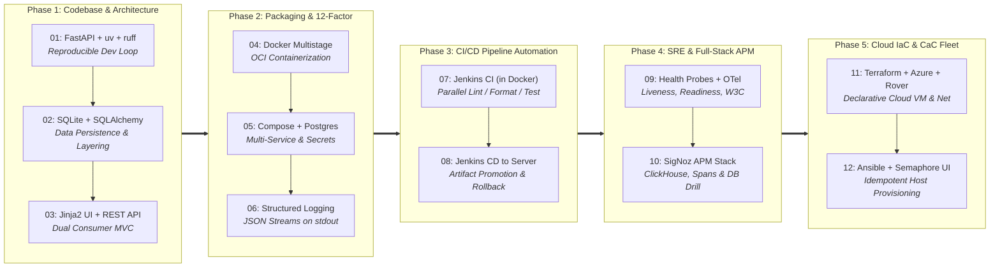

### Phase-by-Phase Evolution Overview

| Phase | Chapters | Focus Domain | Key Technologies | Outcome |
|:---|:---:|:---|:---|:---|
| **1. Application Foundation** | 01 – 03 | Code Hygiene & Persistence | FastAPI, uv, Ruff, SQLite, Jinja2 | Clean MVC app, fast dev loops, dual SSR/API outputs |
| **2. Containerization** | 04 – 06 | Portability & 12-Factor | Docker, Compose, Postgres, JSON Logs | Zero-host-drift OCI images, multi-container networking |
| **3. Pipeline Automation** | 07 – 08 | Automated Quality & Delivery | Jenkins LTS, Docker-in-Docker, SSH/SCP | Automated verification gates & zero-downtime releases |
| **4. Enterprise Observability** | 09 – 10 | Reliability & Root Cause | OpenTelemetry, SigNoz, ClickHouse | Distributed tracing waterfalls, SLO alerts & outage drills |
| **5. Cloud & Configuration** | 11 – 12 | IaC & Fleet Configuration | Terraform, Azure Cloud, Ansible, Semaphore | 1-click cloud provisioning and automated Docker host setups |

---

<div style="page-break-after: always;"></div>

## 1.2 Master System Architecture (End-to-End)

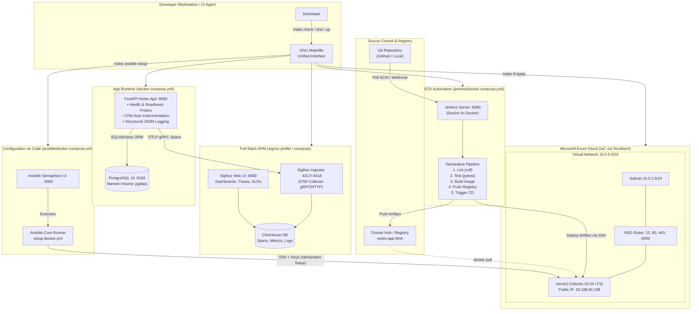

---

<div style="page-break-after: always;"></div>

## 1.3 Master Service & Port Directory

| Service | Environment / Chapter | Container Name | Published Port | Internal Role |
|:---|:---:|:---|:---:|:---|
| **Notes App** | Local / Ch. 1–6, 9 | `notes-app` | `8000:8000` | FastAPI Web UI & REST API |
| **PostgreSQL** | Local / Ch. 5–6, 9–10 | `postgres` | `5432:5432` | Relational application database |
| **Jenkins Master** | Local CI / Ch. 7–8 | `course-jenkins` | `8080:8080` | Continuous Integration / Deployment engine |
| **Jenkins Agent** | Local CI / Ch. 7–8 | Dynamic DinD | `50000:50000` | JNLP agent communication port |
| **SigNoz Ingester** | Observability / Ch. 10 | `signoz-ingester` | `4317:4317` / `4318:4318` | OTLP gRPC and HTTP telemetry intake |
| **SigNoz UI** | Observability / Ch. 10 | `signoz-frontend` | `8080:8080` / `3301` | APM dashboards, traces & alerting portal |
| **Rover Visualizer** | IaC / Ch. 11 | `rover` | `9000:9000` | Terraform interactive graph dashboard |
| **Semaphore Web UI** | CaC / Ch. 12 | `semaphore` | `3000:3000` | Ansible playbooks & project management |
| **Azure VM (`server2`)**| Cloud Target / Ch. 11–12 | Bare Metal VM | `22`, `8000` | Production Ubuntu 22.04 LTS host |

---

## 1.4 The "Zero Host Dependencies" Dockerized Toolchain

Every single piece of operations infrastructure in this course runs inside Docker containers:

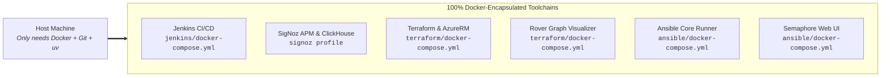

---

<div style="page-break-after: always;"></div>

# 2. Chapter-by-Chapter Visual Dossiers

---

## Chapter 01: FastAPI Foundation & Developer Tooling

> **Milestone**: Establish standard developer ergonomics, sub-second linting, lockfile pinning, and a clean MVC skeleton.

### Problem vs. Solution

| Challenge / Anti-pattern | Solution Introduced | Real-World Impact |
|:---|:---|:---|
| Divergent Python versions and broken `pip install` environments | **Astral `uv`** (`pyproject.toml` + `uv.lock`) | Byte-for-byte reproducible virtual environment in < 100ms |
| Slow, conflicting linters (`flake8`, `black`, `isort`) | **Ruff** single-binary tool | Sub-millisecond formatting and linting in one pass |
| Tangled, unmaintainable single-file scripts | **MVC-Lite separation** (`main.py`, `models.py`, `views.py`) | Route controllers never know where or how data is stored |
| Tribal knowledge for local commands | **GNU `Makefile`** abstraction | Every engineer runs identical `make run`, `make test`, `make lint` |

### Architecture & Request Flow

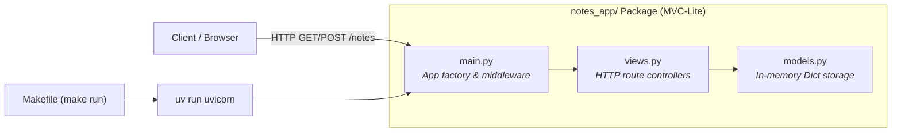

### Technical Specs & Use Case

* **Primary Tech**: Python 3.12, FastAPI, Uvicorn, Astral uv, Ruff, GNU Make.
* **Key Commands**: `make run` (dev server), `make test` (pytest), `make lint` (ruff check), `make lint-fix` (auto-format).
* **Industry Use Case**: Standardizing software engineering teams on a unified command surface so onboarding a new developer takes under 60 seconds without environment debugging.

---

<div style="page-break-after: always;"></div>

## Chapter 02: Durable Storage with SQLite & SQLAlchemy

> **Milestone**: Transition from volatile memory to durable ACID storage without altering a single line of HTTP routing logic.

### Problem vs. Solution

| Challenge / Anti-pattern | Solution Introduced | Real-World Impact |
|:---|:---|:---|
| Data vanishes every time application process restarts | **SQLite 3 file storage** (`notes.db`) | Data persists indefinitely across process restarts |
| Heavy database servers (Postgres/MySQL) required for local dev | **Embedded SQLite file** | Zero background daemons, zero network ports, zero setup |
| Fragile raw SQL queries with injection risks | **SQLAlchemy 2.0 ORM** (`NoteRow`) | Clean Python objects, schema modeling, migration readiness |
| No automated test to verify persistence | **Pytest smoke test suite** (`tests/test_smoke.py`) | CI now has a real integration test to execute |

### Decoupling Architecture

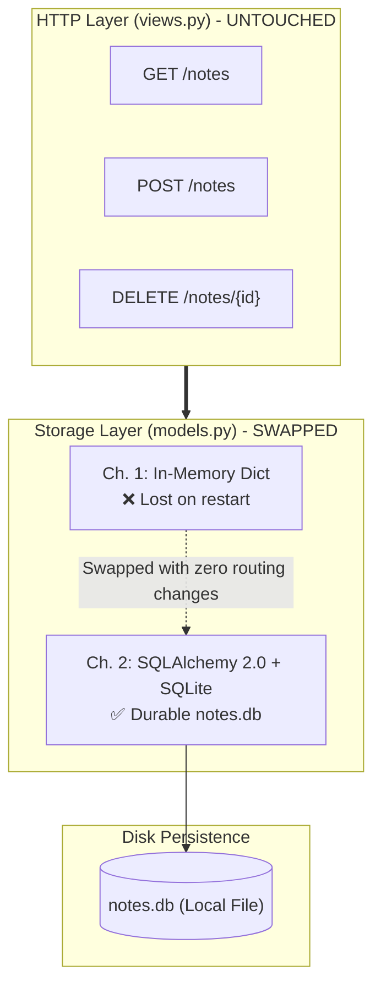

### Technical Specs & Use Case

* **Primary Tech**: SQLite 3, SQLAlchemy 2.0, Pytest.
* **Key Files**: `notes_app/models.py`, `tests/test_smoke.py`, `.gitignore` (`*.db`).
* **Before vs. After**: Restarting `make run` previously wiped all user notes; now notes remain intact on disk.
* **Industry Use Case**: Demonstrating software layering principles—decoupling domain business logic from the persistence implementation so underlying database engines can be swapped freely.

---

<div style="page-break-after: always;"></div>

## Chapter 03: Dual-Consumer Web Interface (Jinja2 SSR & API)

> **Milestone**: Serve server-rendered interactive HTML pages and raw JSON REST endpoints from the exact same application models.

### Problem vs. Solution

| Challenge / Anti-pattern | Solution Introduced | Real-World Impact |
|:---|:---|:---|
| Backend only returns raw JSON blobs; requires Postman to view | **Jinja2 Server-Side Rendering (SSR)** | Full interactive browser UI with CSS and JavaScript |
| Building two separate applications for UI and API | **Dual-Consumer Controller** in `views.py` | Single codebase delivers HTML to humans and JSON to machines |
| Form resubmission duplicates data on page refresh | **Post-Redirect-Get (PRG) Pattern** | Form POST returns `HTTP 303 See Other` to cleanly redirect |
| Monolithic giant HTML files | **Template inheritance** (`templates/base.html`) | Modular, clean templates (`index.html`, `new.html`, `show.html`) |

### Dual Consumer Flowchart

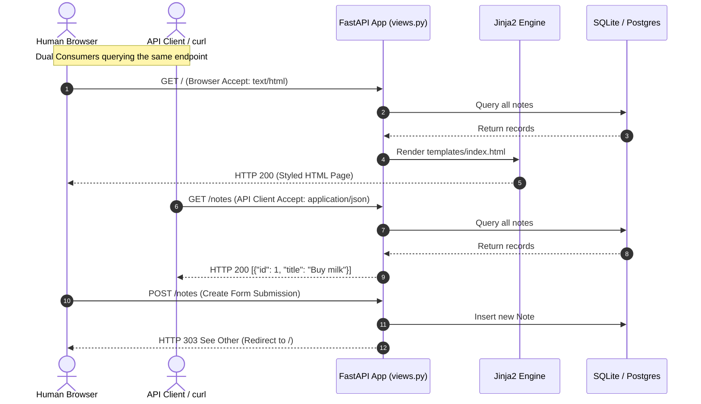

### Technical Specs & Use Case

* **Primary Tech**: Jinja2 Templates, HTML5, CSS3 (`static/style.css`), Vanilla JS (`static/app.js`).
* **Key Files**: `templates/base.html`, `templates/index.html`, `static/style.css`, `notes_app/views.py`.
* **Industry Use Case**: Modern full-stack monoliths (e.g., GitHub, Linear, Basecamp) serving hyper-responsive web interfaces while natively offering public developer APIs from identical models.

---

<div style="page-break-after: always;"></div>

## Chapter 04: Dockerize the App & Reproducible Builds

> **Milestone**: Eliminate "it works on my machine" forever by packaging OS, Python runtime, lockfile dependencies, and code into an immutable OCI container image.

### Problem vs. Solution

| Challenge / Anti-pattern | Solution Introduced | Real-World Impact |
|:---|:---|:---|
| Environmental drift between developer laptops and production servers | **OCI Docker Container** | Identical execution environment across all operating systems |
| Bloated, slow image builds re-downloading packages repeatedly | **uv cache mounts in Dockerfile** | Layer caching makes rebuilds execute in under 2 seconds |
| Leaking local files (`.venv`, `notes.db`, `.git`) into images | Strict **`.dockerignore` rules** | Clean, minimal, secure images with zero secret leakage |
| Running root processes inside containers | **Non-root application user** | Adheres to container security best practices |

### Container Build & Layer Caching

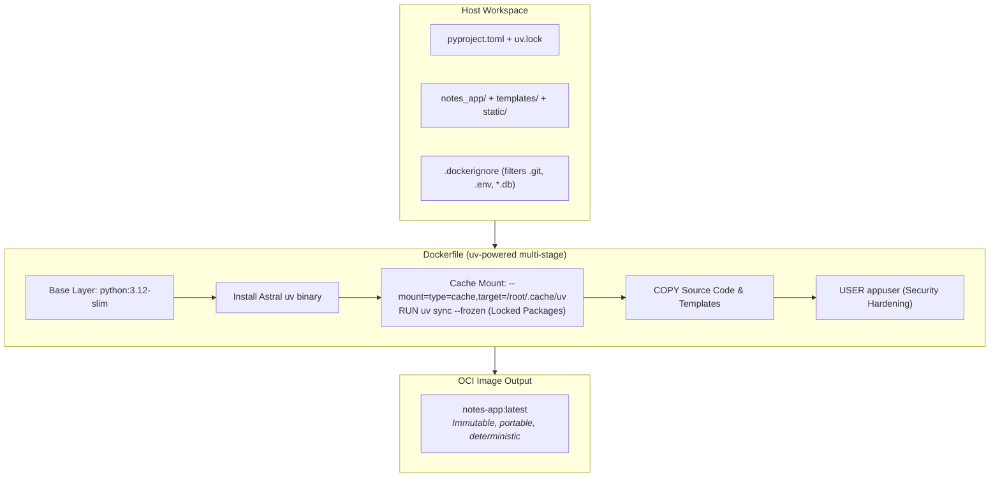

### Technical Specs & Use Case

* **Primary Tech**: Docker Engine, BuildKit, Multi-stage caching, `.dockerignore`.
* **Key Commands**: `make build` (builds `notes-app`), `make run-docker` (starts container on `8000:8000`).
* **Industry Use Case**: Producing standardized, portable deployment units ready to run identically on local laptops, staging clusters, Kubernetes pods, or cloud VMs.

---

<div style="page-break-after: always;"></div>

## Chapter 05: Multi-Container Orchestration & Secrets

> **Milestone**: Move to a production-grade PostgreSQL database, isolate secrets via environment files, and orchestrate multi-container networks using Docker Compose.

### Problem vs. Solution

| Challenge / Anti-pattern | Solution Introduced | Real-World Impact |
|:---|:---|:---|
| SQLite file locked inside container cannot handle enterprise scale | **PostgreSQL 16 Alpine container** | High-concurrency relational DB with ACID guarantees |
| Database data erased when container is recreated | **Docker named volume** (`postgres_data`) | Data survives container restarts and upgrades |
| Hardcoded database credentials in source code | **`.env` and `.env.example`** configuration | 12-Factor compliance; zero credentials committed to Git |
| App crashes on startup because database is still booting | **Healthchecks + `condition: service_healthy`** | Deterministic startup ordering with zero race conditions |
| Single compose file starting everything whether needed or not | **Compose Profiles** (`core`, `db-only`) | Start only what you need: `make up` vs `make up-db` |

### Multi-Service Topology

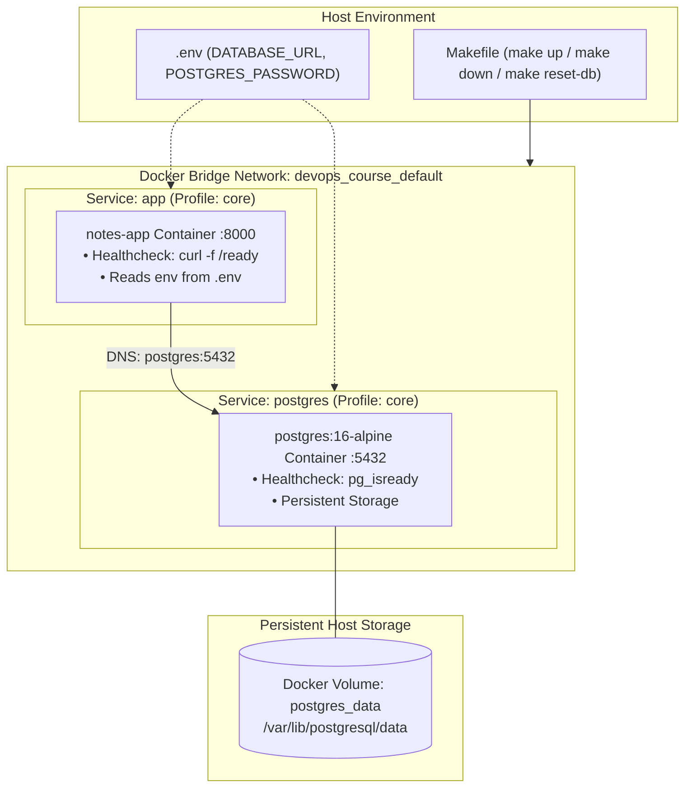

### Technical Specs & Use Case

* **Primary Tech**: Docker Compose v2, PostgreSQL 16 Alpine, Docker Volumes, Healthchecks.
* **Key Commands**: `make up` (starts app + db), `make down` (stops containers), `make reset-db` (wipes volume & re-initializes).
* **Industry Use Case**: Standardizing microservice stacks so all dependent services (databases, caches, queues) spin up with a single command with proper dependencies and persistent storage.

---

<div style="page-break-after: always;"></div>

## Chapter 06: Centralized Structured JSON Logging

> **Milestone**: Replace chaotic human-readable print statements with machine-parseable JSON streams on standard output adhering to 12-Factor principles.

### Problem vs. Solution

| Challenge / Anti-pattern | Solution Introduced | Real-World Impact |
|:---|:---|:---|
| Multi-line console logs cannot be filtered or parsed by SIEM tools | **Structured JSON logging** on `stdout` | Instantly indexable by Datadog, ELK, Fluentbit, and SigNoz |
| Missing contextual metadata (HTTP status, duration, client IP) | **Injected JSON fields** on every request | Full request lifecycle visible in a single log object |
| Writing logs to local files inside containers that fill up disk | **12-Factor App Factor XI** (Streams) | Containers write to stdout/stderr; log collectors ship events |
| No way to trace requests across microservice boundaries | **`request_id` correlation** in log payload | Track single user transactions across all log records |

### Log Ingestion Pipeline

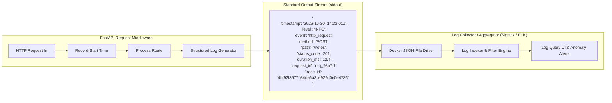

### Technical Specs & Use Case

* **Primary Tech**: Python `logging`, JSON formatter, Docker logging driver, 12-Factor Factor XI.
* **Key Commands**: `make logs` (tails live formatted JSON logs from the running app container).
* **Industry Use Case**: Enterprise observability readiness—ensuring thousands of microservice instances stream uniform, queryable logs for automated alerting, auditing, and debugging.

---

<div style="page-break-after: always;"></div>

## Chapter 07: Containerized Jenkins CI Pipeline

> **Milestone**: Implement a fully automated Continuous Integration pipeline executing linting, formatting, and unit tests in parallel on an isolated Jenkins server.

### Problem vs. Solution

| Challenge / Anti-pattern | Solution Introduced | Real-World Impact |
|:---|:---|:---|
| Developers forget to run tests before committing code | **Automated Jenkins CI Pipeline** | Every commit automatically tested on an independent CI runner |
| "It works on CI but fails locally" due to different CI agents | **Docker-in-Docker CI execution** | CI runs the exact same `Makefile` and Docker commands as developers |
| Sequential CI builds take too long to provide feedback | **Parallel pipeline stages** | Lint, format, and unit tests run concurrently |
| Installing Jenkins directly on host pollutes local environment | **Containerized Jenkins LTS** (`jenkins/`) | Zero host installation; spins up and tears down cleanly |

### Jenkins CI Parallel Pipeline Flow

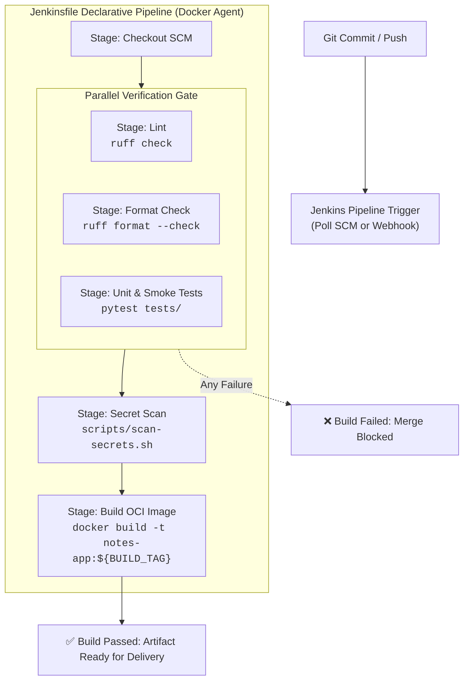

### Technical Specs & Use Case

* **Primary Tech**: Jenkins LTS, Docker-in-Docker (`/var/run/docker.sock`), Jenkins Declarative Pipeline, Blue Ocean.
* **Key Commands**: `make pipeline` (boots Jenkins on `:8080`), `make down-pipeline`, `make reset-pipeline`.
* **Industry Use Case**: Automated quality gates preventing regressions, syntax errors, and broken dependencies from ever reaching mainline branches.

---

<div style="page-break-after: always;"></div>

## Chapter 08: Continuous Delivery & Automated Rollbacks

> **Milestone**: Bridge CI to CD by automating the delivery of immutable container artifacts to a remote production VPS with automated health validation and instant rollbacks.

### Problem vs. Solution

| Challenge / Anti-pattern | Solution Introduced | Real-World Impact |
|:---|:---|:---|
| Building images directly on production servers | **Immutable Artifact Promotion** | Production pulls tested, tagged Docker images from registry |
| Manual SSH deployments with human error | **Automated CD Script** (`server/deploy.sh`) | Single scripted deployment triggered by Jenkins or Makefile |
| Bad deployments cause prolonged production outages | **Automated `/ready` gate & rollback** | If probe fails, the previous working container is restored immediately |
| Exposing unconfigured staging servers | **Environment-driven deployment** | Server configuration cleanly separated from application artifact |

### Deployment & Rollback Sequence

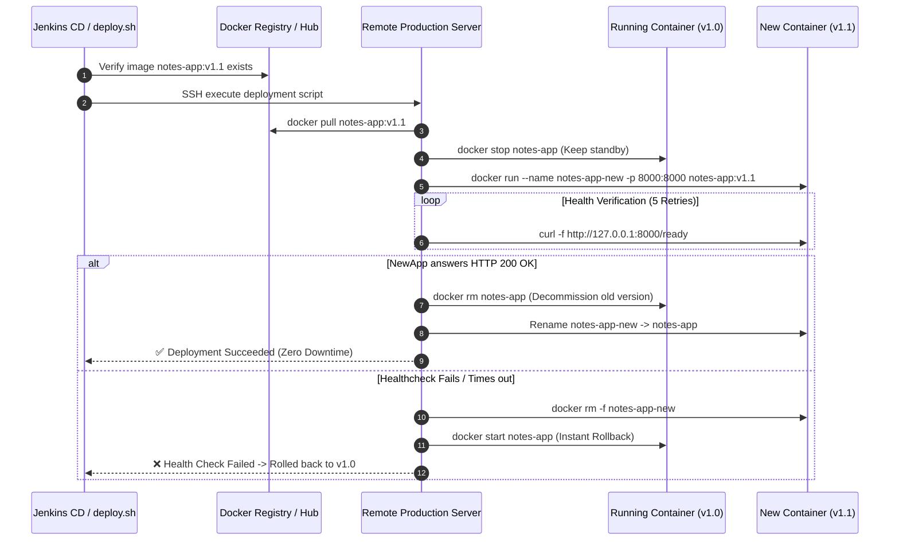

### Technical Specs & Use Case

* **Primary Tech**: SSH/SCP automation, Docker Registry, Bash defensive scripting, Health-gated rollbacks.
* **Key Commands**: `make deploy TAG=notes-app:sha-1234`, `make ssh-server`.
* **Industry Use Case**: Zero-touch production deployments allowing engineering teams to ship updates dozens of times per day with automatic safety nets.

---

<div style="page-break-after: always;"></div>

## Chapter 09: Health Probes & OpenTelemetry Foundation

> **Milestone**: Establish Kubernetes-ready liveness vs. readiness separation and instrument the application with OpenTelemetry distributed trace context.

### Problem vs. Solution

| Challenge / Anti-pattern | Solution Introduced | Real-World Impact |
|:---|:---|:---|
| A single `/health` check that cannot distinguish app crash from DB downtime | **Separate `/health` & `/ready` probes** | Orchestrator knows whether to restart container or stop routing traffic |
| No visibility into latency bottlenecks across database queries | **OpenTelemetry SDK auto-instrumentation** | Every HTTP route and SQL query creates a timed distributed span |
| Disconnected logs and traces during incident investigations | **W3C `traceparent` context injection** | `trace_id` automatically stamped onto application logs |
| Vendor lock-in to proprietary monitoring agents (Datadog/NewRelic) | **OpenTelemetry standard (OTel)** | Open industry standard telemetry streamable to any backend |

### Liveness vs. Readiness Probe Logic

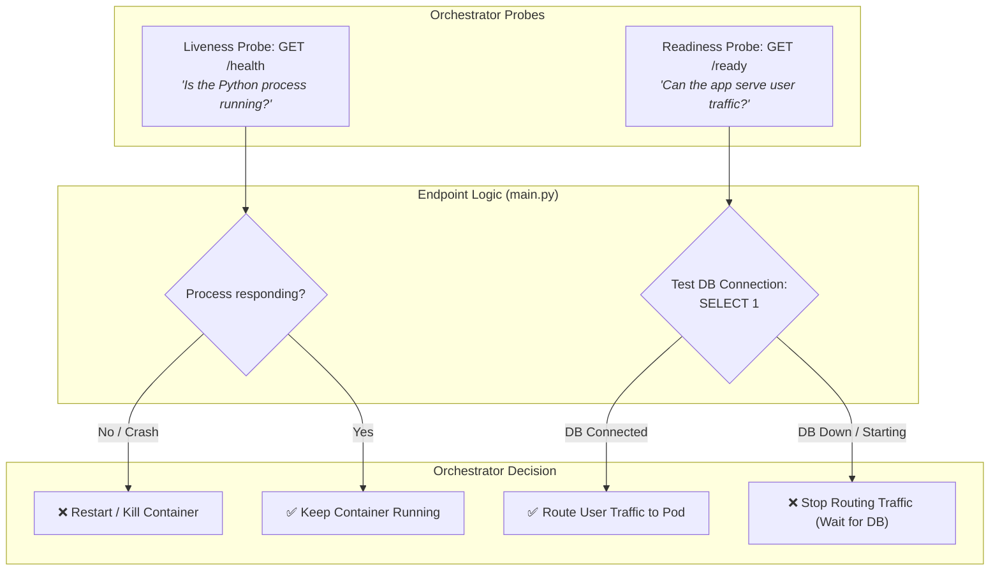

### Technical Specs & Use Case

* **Primary Tech**: OpenTelemetry Python SDK, W3C Trace Context, FastAPI Middleware, SQLAlchemy Instrumentation.
* **Key Endpoints**: `http://127.0.0.1:8000/health`, `http://127.0.0.1:8000/ready`.
* **Industry Use Case**: Production readiness for Kubernetes, AWS ECS, or Azure Container Apps where traffic routing and automated self-healing require distinct probe signals.

---

<div style="page-break-after: always;"></div>

## Chapter 10: Full-Stack Observability with SigNoz & OpenTelemetry

> **Milestone**: Deploy a self-hosted full-stack APM cluster in Docker and prove root-cause identification within seconds via a live database-outage drill.

### Problem vs. Solution

| Challenge / Anti-pattern | Solution Introduced | Real-World Impact |
|:---|:---|:---|
| Traces dumped as text to stdout cannot be visualized or aggregated | **SigNoz APM Stack** (Collector + ClickHouse + UI) | Visual trace waterfalls, latency percentiles (p50/p95/p99) |
| Running separate siloed tools for logs, metrics, and traces | **Unified 3-in-1 APM platform** | Correlate a slow database query directly with its trace and log line |
| Observability is only theoretical; never tested under failure | **Live Incident Drill** (`docker compose stop postgres`) | Watch `/ready` flip to 503, error rate spike to 100%, and SLO alarm fire |
| Expensive SaaS bills for cloud monitoring platforms | **Self-hosted Open-Source APM** | Full telemetry stack running on-premise or inside private cloud |

---

### 10.1 Complete SigNoz Docker Compose Microservice Architecture

The SigNoz stack running via `signoz/compose.yaml` is composed of 7 specialized containers coordinated across a dedicated bridge network (`signoz-network`):

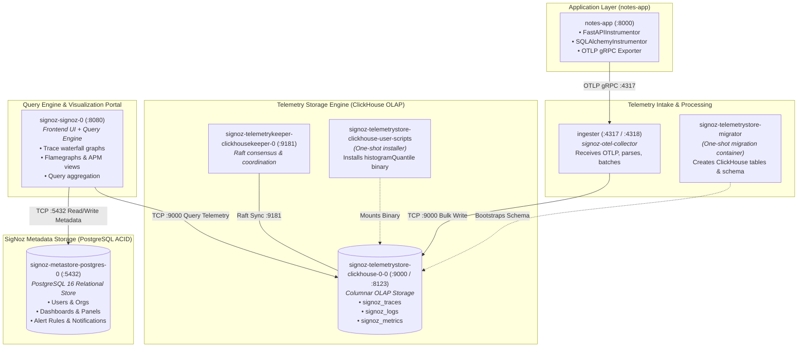

---

<div style="page-break-after: always;"></div>

### 10.2 OpenTelemetry Collector (`ingester`) Internal Pipeline

The `ingester` container runs the SigNoz OpenTelemetry Collector distribution with a multi-stage pipeline defined in `signoz/ingester/ingester.yaml`:

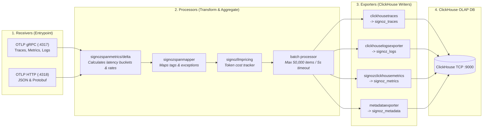

---

### 10.3 Application-Side OpenTelemetry Instrumentation Architecture

Inside `notes_app/otel.py`, the Python runtime is instrumented with zero changes to business routes:

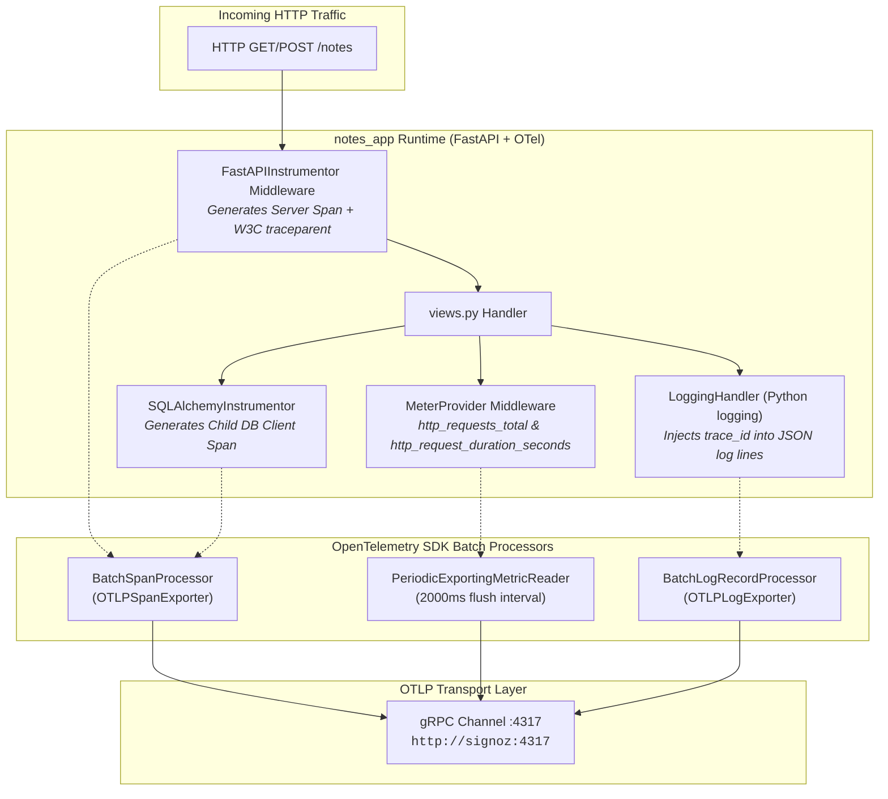

---

<div style="page-break-after: always;"></div>

### 10.4 SigNoz Service & Container Catalog

| Service / Container | Base Docker Image | Network & Ports | Lifecycle | Data Role & Responsibilities |
|:---|:---|:---:|:---:|:---|
| **`ingester`** | `signoz/signoz-otel-collector:latest` | `signoz-network`<br/>`4317` (gRPC), `4318` (HTTP) | Daemon | High-throughput OTel telemetry intake. Processes spans, generates span-metrics, batches writes to ClickHouse. |
| **`signoz-telemetrystore-migrator`** | `signoz/signoz-otel-collector:latest` | `signoz-network` | One-shot Job | Executes ClickHouse DDL migrations (`migrate bootstrap && sync up`). Creates databases, tables, and materialized views. |
| **`signoz-telemetrystore-clickhouse-user-scripts`** | `clickhouse/clickhouse-server:25.12.5` | `signoz-network` | One-shot Job | Downloads and installs the custom `histogram-quantile` binary into the shared volume for p50/p90/p99 calculations. |
| **`signoz-telemetrykeeper-clickhousekeeper-0`** | `clickhouse/clickhouse-keeper:25.12.5` | `signoz-network`<br/>`9181` (Raft client) | Daemon | Raft consensus keeper (ZooKeeper replacement). Coordinates metadata, distributed locks, and mutations for ClickHouse. |
| **`signoz-telemetrystore-clickhouse-0-0`** | `clickhouse/clickhouse-server:25.12.5` | `signoz-network`<br/>`9000` (Native TCP), `8123` (HTTP) | Daemon | Columnar OLAP database. Stores compressed traces, spans, logs, and metrics for analytical querying at scale. |
| **`signoz-metastore-postgres-0`** | `postgres:16` | `signoz-network`<br/>`5432` (Internal) | Daemon | Relational PostgreSQL metadata store for user accounts, organizations, dashboard configurations, and alert rules. |
| **`signoz-signoz-0`** | `signoz/signoz:latest` | `signoz-network`<br/>`8080:8080` (Host Web UI) | Daemon | Unified UI and query engine. Queries ClickHouse for telemetry waterfalls and PostgreSQL for dashboard layouts. |

---

### 10.5 The Incident Drill: Proving Root-Cause Identification

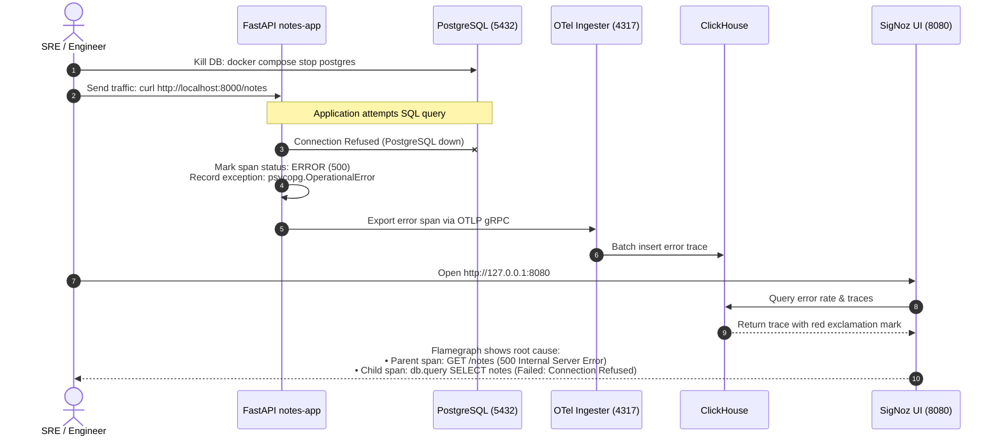

### Technical Specs & Use Case

* **Primary Tech**: SigNoz, OpenTelemetry Collector, ClickHouse Columnar DB, ClickHouse Keeper, PostgreSQL, OTLP gRPC/HTTP.
* **Key Commands**: `make up-signoz` (launches APM on `:8080`), `make down-signoz`, `make reset-signoz`.
* **Industry Use Case**: SRE and production support—diagnosing microsecond latency regressions and cascading downstream outages in seconds without digging through gigabytes of flat log files.

---

<div style="page-break-after: always;"></div>

## Chapter 11: Infrastructure as Code (IaC) with Terraform & Azure

> **Milestone**: Provision production cloud infrastructure (VNet, Subnet, NSG, Public IP, and Ubuntu VM `server2`) in Microsoft Azure using containerized Terraform and the Rover visualizer.

### Problem vs. Solution

| Challenge / Anti-pattern | Solution Introduced | Real-World Impact |
|:---|:---|:---|
| "ClickOps": Manually clicking in Azure/AWS portal causes configuration drift | **HashiCorp Terraform 1.9** declarative code | Infrastructure versioned in Git, auditable, and 100% reproducible |
| Engineers need local Terraform & Azure CLI tools installed on laptops | **Dockerized Terraform runner** | Zero local installs; identical toolchain version pinned for team |
| Accidental cloud bill shocks from forgotten test resources | `make tf-destroy` single-command teardown | Completely wipes all provisioned resources in reverse order |
| Terraform dependency graphs are abstract and hard to understand | **IM Cloud Rover visualizer** (`:9000`) | Interactive 3D web diagram of cloud resources and dependencies |

### Azure Cloud Topology & Rover Architecture

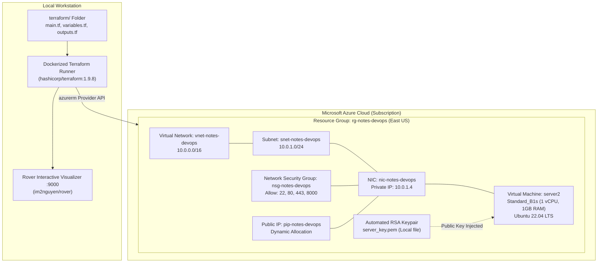

### Technical Specs & Use Case

* **Primary Tech**: HashiCorp Terraform 1.9, AzureRM Provider, Azure Cloud (VM, VNet, NSG, PIP), IM Rover.
* **Key Commands**: `make tf-init`, `make tf-plan`, `make tf-apply`, `make up-rover`, `make tf-destroy`.
* **Industry Use Case**: Enterprise cloud engineering—treating infrastructure as software code, enabling peer-reviewed pull requests for cloud architecture changes, and creating disposable staging environments on demand.

---

<div style="page-break-after: always;"></div>

## Chapter 12: Configuration as Code (CaC) with Ansible & Semaphore

> **Milestone**: Transform a bare Linux cloud VM into a production Docker host using idempotent Ansible playbooks and the self-hosted Semaphore web management UI.

### Problem vs. Solution

| Challenge / Anti-pattern | Solution Introduced | Real-World Impact |
|:---|:---|:---|
| Imperative bash scripts that break or duplicate packages when re-run | **Declarative, idempotent Ansible playbooks** | Running playbook 10 times results in identical state (`changed=0`) |
| Manually SSHing into multiple servers to run apt updates and configs | **Ansible fleet inventory orchestration** | Apply security baselines across 1 or 1,000 servers simultaneously |
| Ansible CLI requires complex terminal flags and local Python packages | **Ansible Semaphore Web UI** (`:3000`) | Clean web portal for project management, keys, and execution logs |
| Losing track of who ran what configuration changes across servers | **Audit log & execution history** in Semaphore | Complete history of runs, parameters, diffs, and results |

### Ansible Fleet Orchestration Architecture

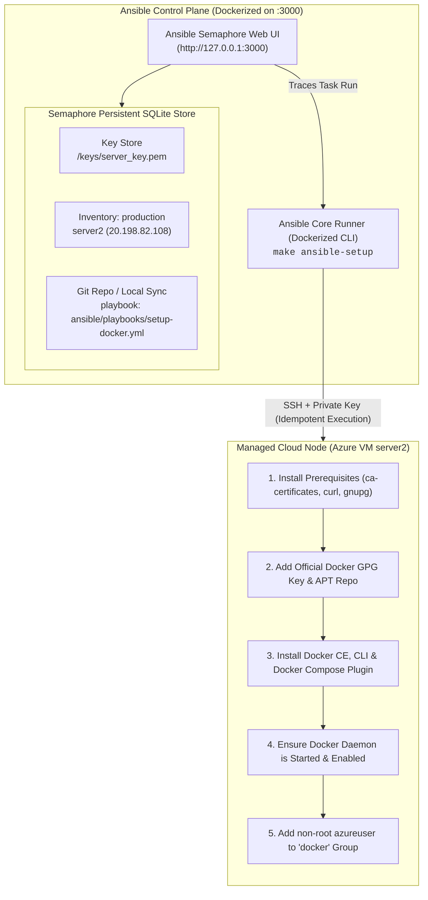

### Technical Specs & Use Case

* **Primary Tech**: Ansible Core 2.17, Ansible Semaphore UI, SQLite/Postgres persistence, Docker CE APT repo.
* **Key Commands**: `make ansible-ping`, `make ansible-check` (dry run), `make ansible-setup` (live run), `make up-ansible-ui`.
* **Industry Use Case**: Automated configuration management, OS security baseline enforcement, and Day-2 operations management across heterogeneous server fleets.

---

<div style="page-break-after: always;"></div>

# 3. Master Synthesis & Capability Matrices

## 3.1 The 12-Chapter Master Comparison Matrix

| # | Chapter Title | Core Technology | Primary Challenge Solved | Key Deliverable | Enterprise Value |
|:---:|:---|:---|:---|:---|:---|
| **01** | FastAPI & Tooling | FastAPI, uv, Ruff, Make | Fragmented dev environments | MVC Skeleton & Makefile | Reproducible dev onboarding |
| **02** | SQLite & SQLAlchemy | SQLite3, SQLAlchemy 2.0 | Volatile in-memory data loss | `notes.db` & Smoke Tests | Layered decoupling & persistence |
| **03** | Jinja2 UI & API | Jinja2, HTML5/CSS3, PRG | Siloed UI and API apps | Dual-consumer `views.py` | Full-stack unified monolith |
| **04** | Docker Containerization | Docker, BuildKit, uv cache | "Works on my machine" drift | Multistage `Dockerfile` | Portable, immutable runtime |
| **05** | Compose & Postgres | Docker Compose, Postgres 16 | Ephemeral single container | Multi-service orchestration | Enterprise DB & secrets management |
| **06** | Structured Logging | Python logging, JSON streams | Unstructured console logs | JSON stdout event logs | 12-Factor log streaming & SIEM |
| **07** | Jenkins CI Pipeline | Jenkins LTS, Docker-in-Docker | Manual, forgotten tests | Parallel CI `Jenkinsfile` | Automated quality & build gates |
| **08** | Continuous Delivery | SSH/SCP, Docker Hub, Bash | Risky manual deployments | `server/deploy.sh` script | Zero-downtime release & rollback |
| **09** | Health Probes & OTel | OpenTelemetry SDK, W3C | Blind orchestrator routing | `/health`, `/ready`, trace_id | Self-healing Kubernetes readiness |
| **10** | SigNoz APM Stack | SigNoz, ClickHouse, OTLP | Reactive outage firefighting | Distributed trace waterfalls | Rapid root-cause analysis & SLOs |
| **11** | Terraform Cloud IaC | Terraform 1.9, Azure, Rover | Error-prone "ClickOps" drift | Azure VM & Rover Visualizer | Declarative cloud infrastructure |
| **12** | Ansible CaC & UI | Ansible, Semaphore UI | Flakey imperative bash setup | Idempotent Docker playbook | Fleet configuration compliance |

---

<div style="page-break-after: always;"></div>

## 3.2 The 12-Factor App Compliance Matrix

| Factor | Factor Name | Implementation in Course | Relevant Chapters |
|:---|:---|:---|:---:|
| **I. Codebase** | One codebase tracked in revision control | Single Git repository across 12 incremental branches | All |
| **II. Dependencies** | Explicitly declare and isolate dependencies | `pyproject.toml` + `uv.lock` + multi-stage Docker build | Ch. 1, 4 |
| **III. Config** | Store config in the environment | `.env` file, environment variables, no hardcoded secrets | Ch. 5, 8, 11 |
| **IV. Backing Services** | Treat backing services as attached resources | Swappable database URLs (`sqlite:///` vs `postgresql://`) | Ch. 2, 5 |
| **V. Build, Release, Run** | Strictly separate build and run stages | Jenkins CI builds image; CD deploys immutable image tag | Ch. 4, 7, 8 |
| **VI. Processes** | Execute the app as one or more stateless processes | App container holds zero local state; state lives in Postgres | Ch. 4, 5 |
| **VII. Port Binding** | Export services via port binding | App binds directly to `:8000` via Uvicorn ASGI server | Ch. 1, 4, 5 |
| **VIII. Concurrency** | Scale out via the process model | Docker Compose multi-container replica readiness | Ch. 5 |
| **IX. Disposability** | Maximize robustness with fast startup & graceful shutdown | Fast boot (< 1s), SIGTERM handling, health checks | Ch. 5, 9 |
| **X. Dev/Prod Parity** | Keep development, staging, and production as similar as possible | Docker Compose locally mirrors remote cloud VM environment | Ch. 4, 5, 8, 12 |
| **XI. Logs** | Treat logs as event streams | Structured JSON logs written directly to `stdout` | Ch. 6, 10 |
| **XII. Admin Processes** | Run admin/management tasks as one-off processes | `make db-shell`, `make reset-db`, Ansible setup tasks | Ch. 5, 12 |

---

<div style="page-break-after: always;"></div>

## 3.3 Complete Operations Command Catalog

### Local Developer Loop
```bash
make check         # Verify local prerequisites (docker daemon, ports, tools)
make run           # Start local FastAPI dev server with auto-reload (:8000)
make test          # Execute pytest test suite
make lint          # Run ruff lint & format checks
make lint-fix      # Automatically fix formatting and lint issues
```

### Application & Database Stack (Docker Compose)
```bash
make build         # Build the immutable notes-app Docker image
make run-docker    # Run the standalone Docker container
make up            # Spin up multi-container stack (App + PostgreSQL)
make down          # Stop and tear down multi-container stack
make logs          # Tail real-time structured JSON logs from stdout
make reset-db      # Wipe PostgreSQL volume and re-initialize
make reset-app     # Wipe app and database state completely
```

### CI/CD Automation (Jenkins)
```bash
make pipeline      # Launch Jenkins CI server in Docker (:8080)
make down-pipeline # Stop Jenkins CI server (preserves volume)
make reset-pipeline# Wipe Jenkins data volume completely
make deploy        # Execute automated CD deployment to target host
```

### Full-Stack APM & Observability (SigNoz)
```bash
make up-signoz     # Launch SigNoz APM cluster (ClickHouse + UI on :8080)
make down-signoz   # Stop SigNoz APM cluster (preserves telemetry)
make reset-signoz  # Wipe all telemetry data in ClickHouse
```

### Cloud Infrastructure as Code (Terraform & Azure)
```bash
make tf-init       # Initialize Terraform & download AzureRM provider in Docker
make tf-plan       # Preview declarative cloud infrastructure plan
make tf-apply      # Provision Azure VM, VNet, Subnet, NSG, and Public IP
make tf-output     # Display Azure VM Public IP and SSH access command
make up-rover      # Launch Rover interactive visualizer on http://127.0.0.1:9000
make down-rover    # Stop Rover visualizer
make tf-destroy    # Tear down and destroy all cloud resources in Azure
```

### Configuration as Code (Ansible & Semaphore UI)
```bash
make ansible-ping  # Test SSH connectivity to cloud host server2
make ansible-check # Dry-run Docker setup playbook (--check --diff)
make ansible-setup # Provision Docker CE, Compose & user groups on server2
make up-ansible-ui # Start Ansible Semaphore Web UI on http://127.0.0.1:3000
make down-ansible-ui # Stop Ansible Semaphore Web UI
```

---

### Master Reset
```bash
make reset-all     # Clean wipe of all volumes: app, postgres, jenkins, and signoz
```

---
*End of DevOps Course Blueprint — Generated for Executive Presentation & PDF Export.*
